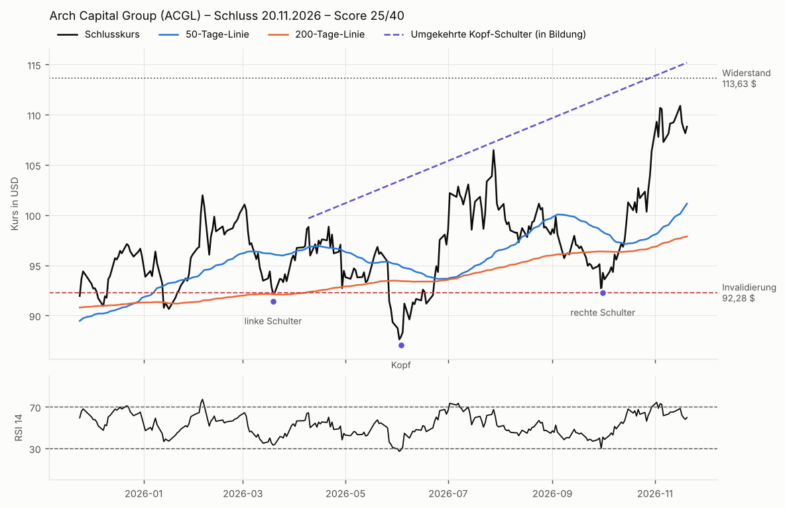
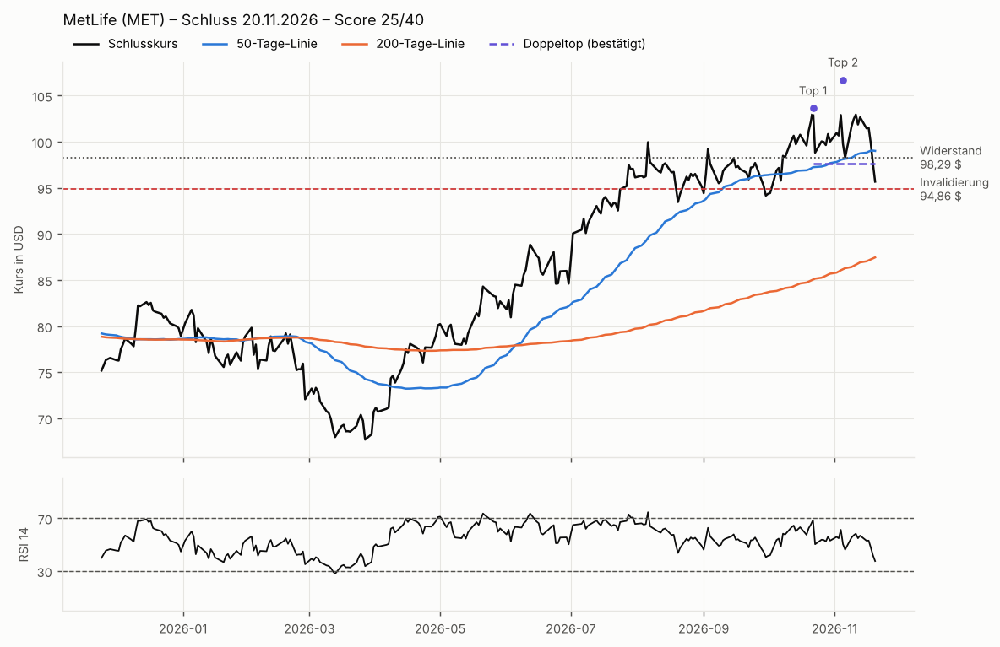
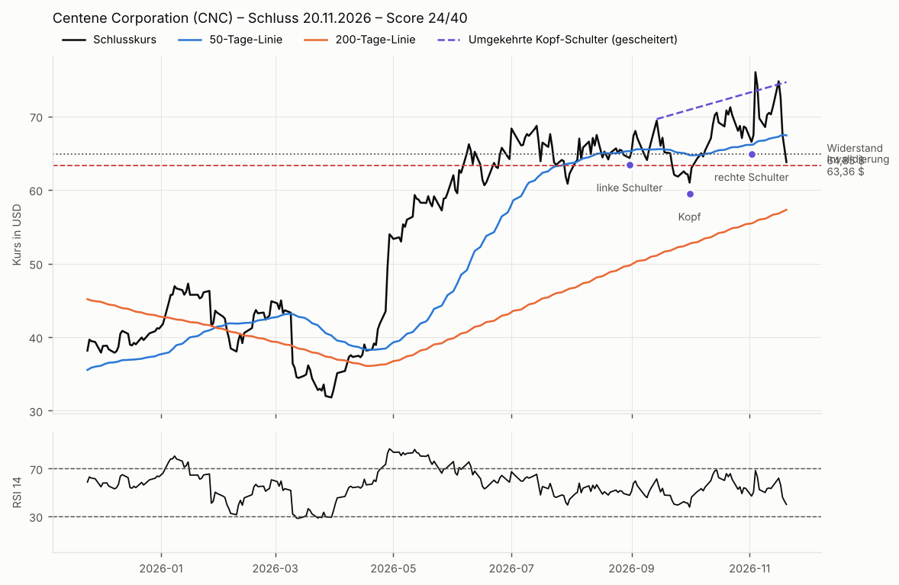
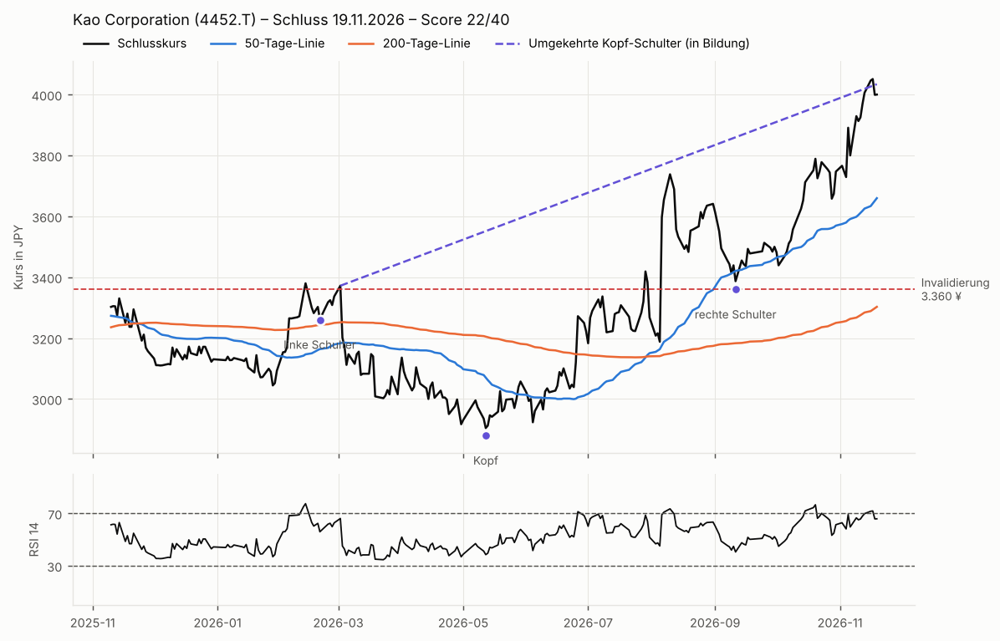
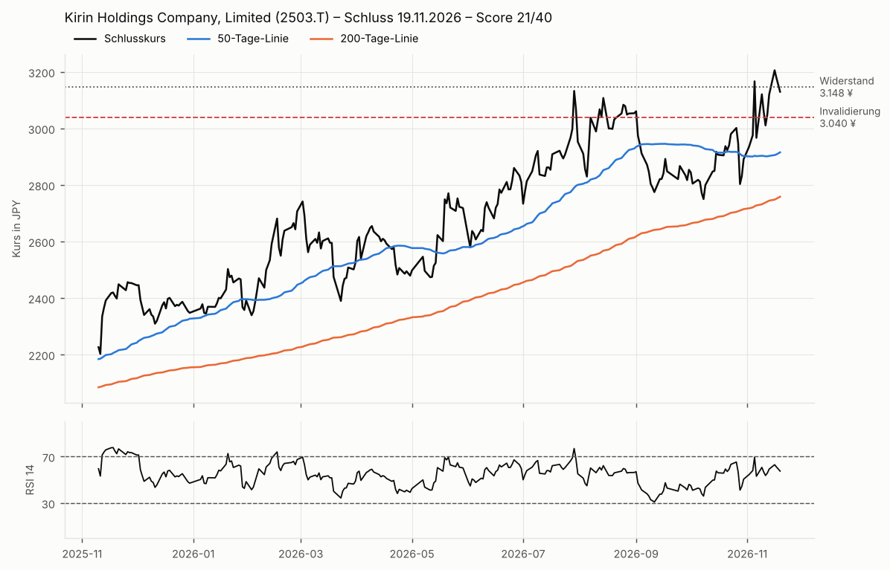
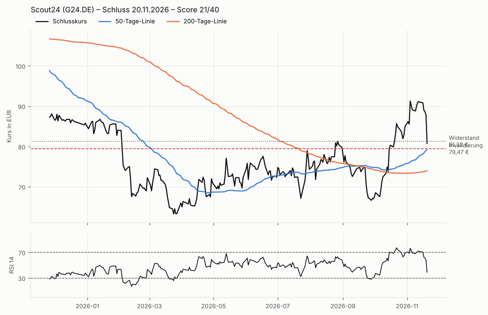

# Aktien-Screener – 20.11.2026

Endbericht mit Websuche (Kurstreiber, Termine, Bull-/Bear-Fall).

Score 0–40. Gewichte: T 1, M 0, R 0, B 1, K 1, E 1. Bereiche mit Gewicht 0 werden angezeigt, zählen aber nicht.

Grund der Gewichtung: Backtest 20.11.2026 (2017–2026): Risiko-Punkte bevorzugten Aktien, die danach zurücklagen (R >= 8: −1,9 Pp. nach 60 Tagen, t −4,7); Muster ohne belastbaren Vorsprung (M > 0: −0,6 Pp., t −2,1). Deshalb vorerst Gewicht 0. B, K, E: Gewicht 1 wie in CLAUDE.md vorgesehen – mangels historischer Fundamentaldaten nicht im Backtest prüfbar; Prüfstein ist das Journal.

**Datenlage**
- Universum: 768 Aktien, nach Filtern 527 (Kurs unter 150 €, Marktkap. ab 1 Mrd. €)
- Vorauswahl: die 40 technisch stärksten; nur sie haben Fundamentaldaten
- Kursstand DAX: 20.11.2026
- Kursstand Nikkei 225: 19.11.2026
- Kursstand S&P 500: 20.11.2026
- Wechselkurs: 1 € = 1,0971 USD (Stand 20.11.2026)
- Wechselkurs: 1 € = 174,1740 JPY (Stand 20.11.2026)
- Kurse und Kennzahlen aus Yahoo Finance können verzögert oder lückenhaft sein.

**Begriffe**
- **RSI (14):** misst, wie stark die Gewinntage der letzten 14 Tage gegenüber den Verlusttagen überwiegen; über 70 überkauft, unter 30 überverkauft.
- **50-/200-Tage-Linie:** Durchschnitt der letzten 50 bzw. 200 Schlusskurse.
- **Golden Cross / Death Cross:** 50-Tage-Linie schneidet die 200-Tage-Linie von unten / von oben.
- **Pp. (Prozentpunkte):** Differenz zweier Prozentwerte, hier Aktie minus Index.
- **KGV:** Kurs-Gewinn-Verhältnis – Kurs geteilt durch den Gewinn je Aktie.
- **EV/EBITDA:** Unternehmenswert (inkl. Schulden) geteilt durch den operativen Gewinn vor Abschreibungen.
- **Nackenlinie / Ausbruchsmarke:** Linie, deren Durchbruch ein Muster bestätigt.
- **Invalidierung:** Marke, bei deren Unterschreiten die Idee falsch ist.
- **Messziel:** klassische Faustregel (Musterhöhe ab der Nackenlinie), keine Prognose.

## Rangliste (Top 8)

1. **Astellas Pharma Inc.** (4503.T) – 25/40 gemischt – Aufwärtstrend, Bewertung günstig, Doppelboden (bestätigt)
2. **Arch Capital Group** (ACGL) – 25/40 gemischt – Aufwärtstrend, Bewertung fair, Umgekehrte Kopf-Schulter (in Bildung)
3. **MetLife** (MET) – 25/40 gemischt – gemischt, Bewertung fair, Doppeltop (bestätigt)
4. **Centene Corporation** (CNC) – 24/40 gemischt – gemischt, Bewertung teuer, Umgekehrte Kopf-Schulter (gescheitert)
5. **Kao Corporation** (4452.T) – 22/40 gemischt – Aufwärtstrend, Bewertung fair, Umgekehrte Kopf-Schulter (in Bildung)
6. **Nisshin Seifun Group Inc.** (2002.T) – 21/40 gemischt – Aufwärtstrend, Bewertung fair, kein Muster
7. **Kirin Holdings Company, Limited** (2503.T) – 21/40 gemischt – Aufwärtstrend, Bewertung günstig, kein Muster
8. **Scout24** (G24.DE) – 21/40 gemischt – Aufwärtstrend, Bewertung günstig, kein Muster

Hohes Potenzial geht fast immer mit hohem Risiko einher. Der Score fasst Indizien zusammen, er ist keine Prognose.

## Ideen

### 1. Astellas Pharma Inc. (4503.T, Tokio) – Score 25/40
T 8 · B 10 · K 2 · E 5 (gewertet) · M 4 · R 4 (nur angezeigt) · **gemischt**

**Setup:** Aufwärtstrend, RSI 67,3 (neutral). Doppelboden (bestätigt, Sicherheit niedrig). Bewertung günstig (KGV 12,8 vs. Branche 21,8).

**Kurs & Trend**
- Kurs: 2.770 ¥ ≈ 15,84 € (Schluss 19.11.2026)
- 52 Wochen: 97 % der Spanne (1.688 ¥ bis 2.800 ¥), -1,1 % zum Hoch
- 50-Tage-Linie 2.431 ¥ (+13,9 %), 200-Tage-Linie 2.354 ¥ (+17,6 %)
- RSI (14): 67,3 – neutral
- vs. Nikkei 225: 1 M +22,6 Pp., 3 M +27,5 Pp., 12 M +22,2 Pp. (Aktie 12 M +44,7 %, Index +22,5 %)
- Volumen: 1,1-fach des 30-Tage-Schnitts

**Muster** (zählt derzeit nicht im Score)
- Doppelboden, **bestätigt**, Erkennungs-Sicherheit niedrig
- Nackenlinie: 2.413 ¥ · Invalidierung: 2.182 ¥
- bestätigt am 21.10.2026
- erfüllt: Volumen an der zweiten Spitze geringer
- weitere Muster: Kopf-Schulter (gescheitert), Doppeltop (gescheitert)

**Invalidierung der Idee:** 2.182 ¥ (Invalidierung Doppelboden), -21,2 % vom Kurs

**Bewertung: günstig** (Kennzahlen Yahoo Finance, Stand 20.11.2026)
- KGV aktuell 12,8, erwartet 13,2
- Branche (Healthcare, Markt jp (13 Werte)): KGV-Median 21,8, EV/EBITDA-Median 11,8
- eigener KGV-Median: 43,0 (4 Geschäftsjahre)
- EV/EBITDA 6,7
- Einordnung: Günstig nur auf dem Papier: Das niedrige KGV spiegelt den absehbaren Wegfall des wichtigsten Produkts. Value-Falle möglich.

**Analysten** (Yahoo Finance)
- Ø-Kursziel 2.633 ¥ (-4,9 % zum Kurs), Spanne 2.000 ¥ bis 3.400 ¥, 14 Analysten
- Gewinnschätzung nächstes Jahr: +7,7 % in 90 Tagen

**Kurstreiber:** Kein fester Termin in den nächsten 8 Wochen gefunden. Strukturelles Thema ist das Auslaufen des Schutzes für XTANDI (Prostatakrebs, über 6 Mrd. $ Jahresumsatz): Eine Exklusivität endete am 17.11.2026, Generika von Enzalutamid sind in den USA zugelassen, ein weiteres Patent läuft laut FDA-Schreiben bis 13.08.2027; Patentstreitigkeiten laufen.
- 17.12.2026: Bank of Japan, Zinsentscheid (17./18.12.; Anhebung auf 1,50 % erwartet) – nur indirekt relevant (Reuters-Umfrage via KFGO, 18.11.2026)
- Warum bewegt: Anstieg nach den Halbjahreszahlen vom 04.11.2026: Umsatz +23,4 %, Kern-Betriebsgewinn rund +50 %, Jahresprognose angehoben (Umsatz auf 2 Bio. ¥). Kurs nahe 52-Wochen-Hoch. Ob der Effekt dauerhaft ist, hängt daran, wie schnell XTANDI-Umsätze an Generika verloren gehen.

**Bull-Fall:** Die angehobene Prognose hält, neue Produkte füllen die XTANDI-Lücke schneller als befürchtet, und das niedrige KGV (12,8 gegenüber 21,8 im Branchenmedian Japan) wird neu bewertet.

**Bear-Fall:** Generika drücken XTANDI-Umsätze stärker als erwartet; das niedrige KGV wäre dann eine Value-Falle. Der Kurs liegt bereits über dem Ø-Kursziel (2.633 ¥). Schlusskurs unter der Nackenlinie 2.413 ¥ schwächt das Bild, unter 2.182 ¥ ist die Idee falsch.

**Eingepreist?** hoch

**Gebühr:** 1 Aktie ≈ 15,84 € → 0,99 € entsprechen 6,25 % des Orderbetrags (hoch – mehrere Stück oder größere Order senken den Anteil)

**Score-Begründung**
- T 8: Kurs über 200-Tage-Linie (+2); Kurs über 50-Tage-Linie (+1); 50- über 200-Tage-Linie (+1); 200-Tage-Linie steigt (+1); stärker als Index (3 Monate) (+1); stärker als Index (12 Monate) (+1); nahe 52-Wochen-Hoch im Aufwärtstrend (+1)
- B 10: KGV aktuell 12,8 vs. Branche 21,8 (+4); KGV vs. eigener Median 43,0 (4 Jahre) (+3); EV/EBITDA 6,7 vs. Branche 11,8 (+3)
- K 2: Nächste Zahlen voraussichtlich Anfang Februar 2027 (nur Yahoo, nicht bestätigt) – außerhalb von 8 Wochen; kein bestätigter Termin im Fenster gefunden.
- E 5: Ø-Kursziel 2632,86 (-4,9 % Abstand) (+0); Empfehlung Ø 2,4 (1 = Kaufen, 5 = Verkaufen) (+0); Gewinnschätzung nächstes Jahr 7,7 % in 90 Tagen (+3); Revisionen 30 Tage: 6 hoch / 1 runter (+2)
- M 4 (nicht gewertet): Doppelboden, bestätigt, Sicherheit niedrig (+4)
- R 4 (nicht gewertet): Volatilität 33 % p. a. (+2); größter Rückgang 12 Monate 21 % (+1); 1 Tagessprünge > 8 % in 12 Monaten (+1); Abstand zur Invalidierung 21,2 % (+0)

**Quellen:** Kursdaten Yahoo Finance (yfinance), Schluss 19.11.2026; Index Nikkei 225 Yahoo Finance; Wechselkurs EUR/JPY Yahoo Finance; Kennzahlen und Analystendaten Yahoo Finance, Stand 20.11.2026
- Simply Wall St (ohne Datum): Kurs +9 % nach Prognoseanhebung und AJICAP-Vereinbarung
- GuruFocus (ohne Datum): starke H1-Zahlen; Zahlen in Quellen teils widersprüchlich (ADR-EPS 0,35 $ vs. Schätzung 0,41 $)
- Investing.com, Jefferies Healthcare Conference (ohne Datum): Fünfjahresplan soll XTANDI-Verlust ausgleichen
- Targeted Oncology (ohne Datum): Exklusivität einer XTANDI-Indikation endet 17.11.2026, Generika zugelassen
- FDA, ANDA-220025-Zulassungsschreiben 2026: Patent 517 bis 13.08.2027
- Daily Political, 19.11.2026: ADR (ALPMY) auf 52-Wochen-Hoch

### 2. Arch Capital Group (ACGL, USA) – Score 25/40
T 8 · B 7 · K 5 · E 5 (gewertet) · M 4 · R 8 (nur angezeigt) · **gemischt**

**Setup:** Aufwärtstrend, RSI 59,8 (neutral). Umgekehrte Kopf-Schulter (in Bildung, Sicherheit mittel). Bewertung fair (KGV 8,9 vs. Branche 12,7).

**Kurs & Trend**
- Kurs: 108,82 $ ≈ 99,19 € (Schluss 20.11.2026)
- 52 Wochen: 82 % der Spanne (87,05 $ bis 113,63 $), -4,2 % zum Hoch
- 50-Tage-Linie 101,14 $ (+7,6 %), 200-Tage-Linie 97,88 $ (+11,2 %)
- RSI (14): 59,8 – neutral
- vs. S&P 500: 1 M +17,8 Pp., 3 M +19,1 Pp., 12 M +12,8 Pp. (Aktie 12 M +18,4 %, Index +5,7 %)
- Volumen: 1,0-fach des 30-Tage-Schnitts

**Muster** (zählt derzeit nicht im Score)
- Umgekehrte Kopf-Schulter, **in Bildung**, Erkennungs-Sicherheit mittel
- Nackenlinie: 115,19 $ · Invalidierung: 92,28 $
- erfüllt: Schultern fast gleich hoch, Kopf deutlich ausgeprägt

**Invalidierung der Idee:** 92,28 $ (Invalidierung Umgekehrte Kopf-Schulter), -15,2 % vom Kurs

**Bewertung: fair** (Kennzahlen Yahoo Finance, Stand 20.11.2026)
- KGV aktuell 8,9, erwartet 10,9
- Branche (Financial Services, Markt us (37 Werte)): KGV-Median 12,7, EV/EBITDA-Median 10,4
- eigener KGV-Median: 8,3 (4 Geschäftsjahre)
- EV/EBITDA 6,8
- Einordnung: Fair bis günstig; das niedrige KGV spiegelt den erwarteten Abschwung im Preiszyklus der Rückversicherung.

**Analysten** (Yahoo Finance)
- Ø-Kursziel 114,11 $ (+4,9 % zum Kurs), Spanne 97,00 $ bis 140,00 $, 19 Analysten
- Gewinnschätzung nächstes Jahr: +2,2 % in 90 Tagen

**Kurstreiber:** Erneuerungsrunde zum 01.01.2027: Für Sachkatastrophen-Rückversicherung erwarten KBW mindestens −10 %, J.P. Morgan −10 bis −20 %, Fitch eine Verlangsamung der Preisrückgänge. Dazu der Fed-Zinsentscheid am 09.12.2026 (Kapitalerträge). Eigene Zahlen: Datum nicht gefunden.
- 09.12.2026: Fed-Zinsentscheid (FOMC 8./9.12.) (Federal Reserve, Kalender Dezember 2026)
- 01.01.2027: Rückversicherungs-Erneuerungsrunde (Preise für Sachkatastrophen erwartet −10 bis −20 %) (Business Insurance / Reinsurance News (J.P. Morgan, Fitch), ohne Datum)
- Warum bewegt: Q3-Zahlen schlugen die Erwartungen, vor allem durch höhere Kapitalerträge. Mizuho (Ziel 109 $, neutral) und Morgan Stanley (113 $, equal-weight) hoben die Ziele an. Ein Insider verkaufte am 10.11.2026 48.661 Aktien zu Ø 108,54 $.

**Bull-Fall:** Niedriges KGV (8,9 vs. Branche 12,7); fallen die Preisrückgänge zum 01.01. milder aus als befürchtet, kann ein Schlusskurs über der Nackenlinie 115,19 $ die umgekehrte Kopf-Schulter bestätigen.

**Bear-Fall:** Deutlichere Preisrückgänge zum 01.01. drücken die Margen; Analysten-Ziele (Ø 114 $) lassen wenig Luft. Das Muster ist nur in Bildung; unter 92,28 $ ist es gescheitert und die Idee falsch.

**Eingepreist?** mittel

**Gebühr:** 1 Aktie ≈ 99,19 € → 0,99 € entsprechen 1,00 % des Orderbetrags

**Score-Begründung**
- T 8: Kurs über 200-Tage-Linie (+2); Kurs über 50-Tage-Linie (+1); 50- über 200-Tage-Linie (+1); 200-Tage-Linie steigt (+1); stärker als Index (3 Monate) (+1); stärker als Index (12 Monate) (+1); nahe 52-Wochen-Hoch im Aufwärtstrend (+1)
- B 7: KGV aktuell 8,9 vs. Branche 12,7 (+3); KGV vs. eigener Median 8,3 (4 Jahre) (+1); EV/EBITDA 6,8 vs. Branche 10,4 (+3)
- K 5: Bestätigter Branchentermin im Fenster – Rückversicherungs-Erneuerungsrunde zum 01.01.2027; Erwartung bekannt (fallende Preise), Ausmaß offen.
- E 5: Ø-Kursziel 114,11 (4,9 % Abstand) (+0); Empfehlung Ø 2,3 (1 = Kaufen, 5 = Verkaufen) (+1); Gewinnschätzung nächstes Jahr 2,2 % in 90 Tagen (+2); Revisionen 30 Tage: 15 hoch / 3 runter (+2)
- M 4 (nicht gewertet): Umgekehrte Kopf-Schulter, in Bildung, Sicherheit mittel (+4)
- R 8 (nicht gewertet): Volatilität 21 % p. a. (+4); größter Rückgang 12 Monate 14 % (+2); 0 Tagessprünge > 8 % in 12 Monaten (+2); Abstand zur Invalidierung 15,2 % (+0)

**Quellen:** Kursdaten Yahoo Finance (yfinance), Schluss 20.11.2026; Index S&P 500 Yahoo Finance; Wechselkurs EUR/USD Yahoo Finance; Kennzahlen und Analystendaten Yahoo Finance, Stand 20.11.2026
- MarketBeat, 20.11.2026: Mizuho hebt Ziel auf 109 $ (neutral); Konsens „Hold“, Ø-Ziel 112,29 $
- Defense World, 18.11.2026: Morgan Stanley Ziel 113 $ (equal-weight)
- Google Finance (ohne Datum): Q3 über Erwartungen; Übernahme von Premier Dealer Holding
- Business Insurance (ohne Datum): J.P. Morgan erwartet −10 bis −20 % bei Sachkatastrophen-Rückversicherung zum 01.01.2027
- Reinsurance News (ohne Datum): Fitch erwartet weiter fallende, aber langsamer sinkende Preise

### 3. MetLife (MET, USA) – Score 25/40
T 8 · B 6 · K 4 · E 7 (gewertet) · M 0 · R 8 (nur angezeigt) · **gemischt**

**Setup:** Technisch angeschlagen: bestätigtes Doppeltop, Kurs direkt an der Unterstützung, RSI 37,6. Fundamental solide (Rekordquartal, Rückkäufe), Bewertung fair. Das Chartbild spricht derzeit gegen einen Einstieg – Signal schwach.

**Kurs & Trend**
- Kurs: 95,67 $ ≈ 87,20 € (Schluss 20.11.2026)
- 52 Wochen: 72 % der Spanne (67,33 $ bis 106,72 $), -10,4 % zum Hoch
- 50-Tage-Linie 99,01 $ (-3,4 %), 200-Tage-Linie 87,46 $ (+9,4 %)
- RSI (14): 37,6 – neutral
- vs. S&P 500: 1 M +5,0 Pp., 3 M +11,9 Pp., 12 M +23,7 Pp. (Aktie 12 M +29,4 %, Index +5,7 %)
- Volumen: 1,3-fach des 30-Tage-Schnitts

**Muster** (zählt derzeit nicht im Score)
- Doppeltop, **bestätigt**, Erkennungs-Sicherheit niedrig
- Nackenlinie: 97,66 $ · Invalidierung: 106,72 $
- bestätigt am 20.11.2026

**Invalidierung der Idee:** 94,86 $ (nächste Unterstützung), -0,8 % vom Kurs

**Bewertung: fair** (Kennzahlen Yahoo Finance, Stand 20.11.2026)
- KGV aktuell 12,5, erwartet 8,6
- Branche (Financial Services, Markt us (37 Werte)): KGV-Median 12,7, EV/EBITDA-Median 10,4
- eigener KGV-Median: 20,6 (4 Geschäftsjahre)
- EV/EBITDA 10,9
- Einordnung: Fair im Branchenvergleich (KGV 12,5 vs. 12,7); GuruFocus sieht das KGV über dem eigenen 5-Jahres-Median.

**Analysten** (Yahoo Finance)
- Ø-Kursziel 111,12 $ (+16,2 % zum Kurs), Spanne 84,00 $ bis 131,00 $, 16 Analysten
- Gewinnschätzung nächstes Jahr: +0,8 % in 90 Tagen

**Kurstreiber:** Fed-Zinsentscheid am 09.12.2026 – für Lebensversicherer über die Kapitalanlagen relevant. Nächste Quartalszahlen: Datum nicht gefunden (üblicherweise Anfang Februar).
- 09.12.2026: Fed-Zinsentscheid (FOMC 8./9.12.) (Federal Reserve, Kalender Dezember 2026)
- Warum bewegt: Q3-Zahlen am 04.11.2026 stark (bereinigtes EPS ohne Sondereffekte 2,85 $, Rekord; 650 Mio. $ Aktienrückkäufe). Am 05.11. fiel die Aktie trotzdem um 3 % – ein Grund wurde nicht gefunden.

**Bull-Fall:** Rekordergebnis und Rückkäufe tragen; erwartetes KGV 8,6 und Ø-Kursziel 111,12 $ (+16 %). Ein Schlusskurs zurück über die Nackenlinie 97,66 $ würde das Doppeltop entkräften.

**Bear-Fall:** Das Doppeltop ist bestätigt (bärisches Muster, Kurs unter der Nackenlinie 97,66 $), und der Kurs steht direkt an der Unterstützung 94,86 $. Schlusskurs darunter: Idee falsch.

**Eingepreist?** mittel

**Warnungen**
- bärisches Muster: Doppeltop (bestätigt)

**Gebühr:** 1 Aktie ≈ 87,20 € → 0,99 € entsprechen 1,14 % des Orderbetrags (hoch – mehrere Stück oder größere Order senken den Anteil)

**Score-Begründung**
- T 8: Kurs über 200-Tage-Linie (+2); 50- über 200-Tage-Linie (+1); 200-Tage-Linie steigt (+1); stärker als Index (3 Monate) (+1); stärker als Index (12 Monate) (+1); Rücksetzer im langfristigen Trend (RSI < 40, über 200-Tage-Linie) (+2)
- B 6: KGV aktuell 12,5 vs. Branche 12,7 (+2); KGV vs. eigener Median 20,6 (4 Jahre) (+3); EV/EBITDA 10,9 vs. Branche 10,4 (+1)
- K 4: Einziger bestätigter Termin im Fenster ist der Fed-Zinsentscheid am 09.12.2026 (Branchenbezug Lebensversicherer); eigene Zahlen erst Anfang 2027 (Datum nicht gefunden).
- E 7: Ø-Kursziel 111,12 (16,2 % Abstand) (+2); Empfehlung Ø 1,9 (1 = Kaufen, 5 = Verkaufen) (+1); Gewinnschätzung nächstes Jahr 0,8 % in 90 Tagen (+2); Revisionen 30 Tage: 6 hoch / 2 runter (+2)
- M 0 (nicht gewertet): Abzug für bärisches Muster (−4)
- R 8 (nicht gewertet): Volatilität 24 % p. a. (+3); größter Rückgang 12 Monate 18 % (+1); 0 Tagessprünge > 8 % in 12 Monaten (+2); Abstand zur Invalidierung 0,8 % (+2)

**Quellen:** Kursdaten Yahoo Finance (yfinance), Schluss 20.11.2026; Index S&P 500 Yahoo Finance; Wechselkurs EUR/USD Yahoo Finance; Kennzahlen und Analystendaten Yahoo Finance, Stand 20.11.2026
- MetLife, Form 8-K (SEC), 04.11.2026: Q3-2026-Ergebnis
- Barchart via Yahoo Finance (ohne Datum): Aktie +2,2 % nach den Zahlen; Umsatzangaben je nach Maß unterschiedlich
- GuruFocus, 05.11.2026: Aktie −3,0 % auf 99,75 $, Grund nicht genannt
- Federal Reserve, Kalender Dezember 2026: FOMC 8./9.12.2026 (vorläufig)

### 4. Centene Corporation (CNC, USA) – Score 24/40
T 8 · B 5 · K 4 · E 7 (gewertet) · M 0 · R 2 (nur angezeigt) · **gemischt**

**Setup:** Technisch schwach: Muster gescheitert, Kurs an der Unterstützung nach dem Branchenabverkauf vom 18./19.11. Fundamental Erholungsgeschichte mit angehobener Prognose 2026, aber hohem Regulierungsrisiko.

**Kurs & Trend**
- Kurs: 63,78 $ ≈ 58,14 € (Schluss 20.11.2026)
- 52 Wochen: 69 % der Spanne (31,63 $ bis 78,08 $), -18,3 % zum Hoch
- 50-Tage-Linie 67,41 $ (-5,4 %), 200-Tage-Linie 57,30 $ (+11,3 %)
- RSI (14): 40,0 – neutral
- vs. S&P 500: 1 M +0,5 Pp., 3 M +9,0 Pp., 12 M +77,4 Pp. (Aktie 12 M +83,1 %, Index +5,7 %)
- Volumen: 1,3-fach des 30-Tage-Schnitts

**Muster** (zählt derzeit nicht im Score)
- Umgekehrte Kopf-Schulter, **gescheitert**, Erkennungs-Sicherheit mittel
- Nackenlinie: 74,65 $ · Invalidierung: 64,85 $
- bestätigt am 04.11.2026
- gescheitert am 20.11.2026
- erfüllt: zeitlich symmetrisch, Kopf deutlich ausgeprägt

**Invalidierung der Idee:** 63,36 $ (nächste Unterstützung), -0,7 % vom Kurs

**Bewertung: teuer** (Kennzahlen Yahoo Finance, Stand 20.11.2026)
- KGV aktuell 21,9, erwartet 11,4
- Branche (Healthcare, Markt us (22 Werte)): KGV-Median 23,7, EV/EBITDA-Median 12,5
- eigener KGV-Median: 15,0 (3 Geschäftsjahre)
- EV/EBITDA 5,2
- Einordnung: Nach aktuellem KGV teuer, nach erwartetem KGV (11,4) günstig – das hängt an der Prognose 2027, die noch fehlt.

**Analysten** (Yahoo Finance)
- Ø-Kursziel 76,11 $ (+19,3 % zum Kurs), Spanne 62,00 $ bis 90,00 $, 18 Analysten
- Gewinnschätzung nächstes Jahr: +4,9 % in 90 Tagen

**Kurstreiber:** Zum 01.01.2027 werden rund 40 % der Medicaid-Umsätze neu bepreist. Formale Prognose 2027 erst mit den Q4-Zahlen, gelistet für 08.02.2027. Offener CMS-Vorschlag zu ausgeweiteten Prüfungen im Medicare-Advantage-Geschäft (Kommentierungsfrist: Datum nicht gefunden).
- 01.01.2027: Neue Medicaid-Raten für rund 40 % des Medicaid-Umsatzes (Yahoo Finance, Q3-Call-Zusammenfassung (ohne Datum))
- 08.02.2027: Q4-Zahlen und Prognose 2027 (gelistet, nicht bestätigt) (Websuche-Zusammenfassung, ohne Primärquelle)
- Warum bewegt: Am 18.11.2026 −7 % ohne Firmenmeldung, mit allen großen Krankenversicherern – Auslöser war ein CMS-Vorschlag zu Medicare-Advantage-Prüfungen; am 19.11. weitere Verluste. Branchenrisiko, dauerhaft nur, wenn der Vorschlag so umgesetzt wird.

**Bull-Fall:** Prognose 2026 auf über 5,20 $ EPS angehoben, Medicaid-Kostenquote verbessert; erwartetes KGV 11,4, Ø-Kursziel 76,11 $ (+19 %). Entschärft sich der CMS-Vorschlag, kann sich der Branchenabschlag auflösen.

**Bear-Fall:** Regulierung ist ein binäres Risiko (CMS-Prüfungen, Medicaid-Arbeitspflichten senken die Mitgliederqualität). Die umgekehrte Kopf-Schulter ist gescheitert, der Kurs steht an der Unterstützung 63,36 $ – Schlusskurs darunter: Idee falsch.

**Eingepreist?** mittel

**Warnungen**
- hohe Volatilität
- häufige große Tagessprünge (binäre Ereignisse?)

**Gebühr:** 1 Aktie ≈ 58,14 € → 0,99 € entsprechen 1,70 % des Orderbetrags (hoch – mehrere Stück oder größere Order senken den Anteil)

**Score-Begründung**
- T 8: Kurs über 200-Tage-Linie (+2); 50- über 200-Tage-Linie (+1); 200-Tage-Linie steigt (+1); stärker als Index (3 Monate) (+1); stärker als Index (12 Monate) (+1); Rücksetzer im langfristigen Trend (RSI < 40, über 200-Tage-Linie) (+2)
- B 5: KGV aktuell 21,9 vs. Branche 23,7 (+2); KGV vs. eigener Median 15,0 (3 Jahre) (+0); EV/EBITDA 5,2 vs. Branche 12,5 (+3)
- K 4: Bestätigter Stichtag 01.01.2027 (neue Medicaid-Raten für rund 40 % des Medicaid-Umsatzes); Wirkung erst mit den Zahlen am 08.02.2027 sichtbar (außerhalb des Fensters).
- E 7: Ø-Kursziel 76,11 (19,3 % Abstand) (+2); Empfehlung Ø 2,4 (1 = Kaufen, 5 = Verkaufen) (+0); Gewinnschätzung nächstes Jahr 4,9 % in 90 Tagen (+3); Revisionen 30 Tage: 12 hoch / 4 runter (+2)
- M 0 (nicht gewertet): kein bullisches Muster
- R 2 (nicht gewertet): Volatilität 45 % p. a. (+0); größter Rückgang 12 Monate 33 % (+0); 5 Tagessprünge > 8 % in 12 Monaten (+0); Abstand zur Invalidierung 0,7 % (+2)

**Quellen:** Kursdaten Yahoo Finance (yfinance), Schluss 20.11.2026; Index S&P 500 Yahoo Finance; Wechselkurs EUR/USD Yahoo Finance; Kennzahlen und Analystendaten Yahoo Finance, Stand 20.11.2026
- Yahoo Finance, „What Centene (CNC) Said on Its Q3 Earnings Call“ (ohne Datum): Prognose 2026 > 5,20 $, 40 % der Medicaid-Raten zum 01.01.
- Trefis, 19.11.2026: Kursrückgang mit Branchenwerten, keine Firmenmeldung
- Alphastreet (ohne Datum): Centene −5,5 % im Branchenabverkauf
- OptionBeast, 19.11.2026: CMS-Vorschlag zu Medicare-Advantage-Prüfungen, noch nicht in Kraft

### 5. Kao Corporation (4452.T, Tokio) – Score 22/40
T 8 · B 3 · K 3 · E 8 (gewertet) · M 4 · R 7 (nur angezeigt) · **gemischt**

**Setup:** Aufwärtstrend, RSI 65,9 (neutral). Umgekehrte Kopf-Schulter (in Bildung, Sicherheit mittel). Bewertung fair (KGV 25,7 vs. Branche 21,7).

**Kurs & Trend**
- Kurs: 4.000 ¥ ≈ 22,87 € (Schluss 19.11.2026)
- 52 Wochen: 92 % der Spanne (2.880 ¥ bis 4.101 ¥), -2,5 % zum Hoch
- 50-Tage-Linie 3.660 ¥ (+9,3 %), 200-Tage-Linie 3.303 ¥ (+21,1 %)
- RSI (14): 65,9 – neutral
- vs. Nikkei 225: 1 M +15,1 Pp., 3 M +23,8 Pp., 12 M +1,1 Pp. (Aktie 12 M +23,6 %, Index +22,5 %)
- Volumen: 0,7-fach des 30-Tage-Schnitts

**Muster** (zählt derzeit nicht im Score)
- Umgekehrte Kopf-Schulter, **in Bildung**, Erkennungs-Sicherheit mittel
- Nackenlinie: 4.034 ¥ · Invalidierung: 3.360 ¥
- erfüllt: Kopf deutlich ausgeprägt, Volumen an der rechten Schulter geringer
- weitere Muster: Doppeltop (gescheitert)

**Invalidierung der Idee:** 3.360 ¥ (Invalidierung Umgekehrte Kopf-Schulter), -16,0 % vom Kurs

**Bewertung: fair** (Kennzahlen Yahoo Finance, Stand 20.11.2026)
- KGV aktuell 25,7, erwartet 23,7
- Branche (Consumer Defensive, Markt jp (15 Werte)): KGV-Median 21,7, EV/EBITDA-Median 9,3
- eigener KGV-Median: 28,1 (4 Geschäftsjahre)
- EV/EBITDA 13,5
- Einordnung: Fair bis teuer im Branchenvergleich; die Erholung ist im Kurs weitgehend enthalten.

**Analysten** (Yahoo Finance)
- Ø-Kursziel 4.242 ¥ (+6,0 % zum Kurs), Spanne 3.800 ¥ bis 4.950 ¥, 15 Analysten
- Gewinnschätzung nächstes Jahr: +4,1 % in 90 Tagen

**Kurstreiber:** Neues Aktionärsprogramm, erstmals für Aktionäre zum Stichtag Ende Dezember 2026 (genaues Datum nicht gefunden; ob es für Depots bei Scalable gilt, nicht geprüft). Jahreszahlen Anfang Februar 2027.
- Zahlentermin laut Yahoo (ungeprüft): 04.02.2027
- Warum bewegt: Q3-Zahlen am 05.11.2026 über den Erwartungen: Betriebsgewinn 50,7 Mrd. ¥ statt erwarteter 45,8 Mrd. ¥, Nettogewinn nach 9 Monaten +24 %, Jahresprognose bestätigt. Kurs vor den Zahlen bei rund 3.400 ¥, danach rund 4.000 ¥.

**Bull-Fall:** Operative Erholung bestätigt, 36 Jahre steigende Dividende; ein Schlusskurs über der Nackenlinie 4.034 ¥ würde die umgekehrte Kopf-Schulter bestätigen.

**Bear-Fall:** Bewertung bereits über dem Branchenmedian (KGV 25,7 vs. 21,7) nach einem Anstieg um rund 17 % seit Oktober. Muster nur in Bildung; unter 3.360 ¥ gescheitert und Idee falsch.

**Eingepreist?** hoch

**Gebühr:** 1 Aktie ≈ 22,87 € → 0,99 € entsprechen 4,33 % des Orderbetrags (hoch – mehrere Stück oder größere Order senken den Anteil)

**Score-Begründung**
- T 8: Kurs über 200-Tage-Linie (+2); Kurs über 50-Tage-Linie (+1); 50- über 200-Tage-Linie (+1); 200-Tage-Linie steigt (+1); stärker als Index (3 Monate) (+1); stärker als Index (12 Monate) (+1); nahe 52-Wochen-Hoch im Aufwärtstrend (+1)
- B 3: KGV aktuell 25,7 vs. Branche 21,7 (+1); KGV vs. eigener Median 28,1 (4 Jahre) (+2); EV/EBITDA 13,5 vs. Branche 9,3 (+0)
- K 3: Im Fenster nur der Stichtag Ende Dezember 2026 für das neue Aktionärsprogramm (geringe Kursrelevanz); Jahreszahlen laut Yahoo 04.02.2027, nicht bestätigt.
- E 8: Ø-Kursziel 4242,00 (6,0 % Abstand) (+1); Empfehlung Ø 1,6 (1 = Kaufen, 5 = Verkaufen) (+2); Gewinnschätzung nächstes Jahr 4,1 % in 90 Tagen (+3); Revisionen 30 Tage: 4 hoch / 0 runter (+2)
- M 4 (nicht gewertet): Umgekehrte Kopf-Schulter, in Bildung, Sicherheit mittel (+4)
- R 7 (nicht gewertet): Volatilität 19 % p. a. (+4); größter Rückgang 12 Monate 14 % (+2); 1 Tagessprünge > 8 % in 12 Monaten (+1); Abstand zur Invalidierung 16,0 % (+0)

**Quellen:** Kursdaten Yahoo Finance (yfinance), Schluss 19.11.2026; Index Nikkei 225 Yahoo Finance; Wechselkurs EUR/JPY Yahoo Finance; Kennzahlen und Analystendaten Yahoo Finance, Stand 20.11.2026
- Investing.com (ohne Datum): Q3-Betriebsgewinn 50,7 Mrd. ¥, über Erwartung
- Kabutan, 05.11.2026: 9-Monats-Nettogewinn +24 %, Q3 +12 %
- Kabuyoho/Websuche: Schlusskurs 13.11.2026 4.006 ¥, Dividendenrendite 1,95 %
- LIMO via Yahoo! Finance Japan (ohne Datum): 36 Jahre Dividendensteigerung, neues Aktionärsprogramm ab Stichtag Ende Dezember 2026

### 6. Nisshin Seifun Group Inc. (2002.T, Tokio) – Score 21/40
T 8 · B 6 · K 2 · E 5 (gewertet) · M 0 · R 7 (nur angezeigt) · **gemischt**

**Setup:** Aufwärtstrend, RSI 64,9 (neutral). Kein Chartmuster erkannt. Bewertung fair (KGV 16,8 vs. Branche 21,7).

**Kurs & Trend**
- Kurs: 2.430 ¥ ≈ 13,90 € (Schluss 19.11.2026)
- 52 Wochen: 89 % der Spanne (1.768 ¥ bis 2.512 ¥), -3,3 % zum Hoch
- 50-Tage-Linie 2.123 ¥ (+14,5 %), 200-Tage-Linie 2.057 ¥ (+18,1 %)
- RSI (14): 64,9 – neutral
- vs. Nikkei 225: 1 M +27,3 Pp., 3 M +28,8 Pp., 12 M +9,3 Pp. (Aktie 12 M +31,7 %, Index +22,5 %)
- Volumen: 1,1-fach des 30-Tage-Schnitts

**Muster** (zählt derzeit nicht im Score)
- kein Muster erkannt

**Invalidierung der Idee:** 2.187 ¥ (nächste Unterstützung), -10,0 % vom Kurs

**Bewertung: fair** (Kennzahlen Yahoo Finance, Stand 20.11.2026)
- KGV aktuell 16,8, erwartet 16,0
- Branche (Consumer Defensive, Markt jp (15 Werte)): KGV-Median 21,7, EV/EBITDA-Median 9,3
- eigener KGV-Median: 18,5 (3 Geschäftsjahre)
- EV/EBITDA 9,0
- Einordnung: Fair; ohne die Einmaleffekte wäre das KGV höher.

**Analysten** (Yahoo Finance)
- Ø-Kursziel 2.374 ¥ (-2,3 % zum Kurs), Spanne 2.220 ¥ bis 2.500 ¥, 5 Analysten
- Gewinnschätzung nächstes Jahr: +6,6 % in 90 Tagen

**Kurstreiber:** Kein fester Termin in den nächsten 8 Wochen gefunden. Laufender Aktienrückkauf von bis zu 20 Mrd. ¥ bzw. 14 Mio. Aktien (Zeitraum nicht gefunden).
- Zahlentermin laut Yahoo (ungeprüft): 29.01.2027
- Warum bewegt: Halbjahreszahlen am 28.10.2026: Umsatzprognose von 870 auf 900 Mrd. ¥ angehoben, Rückkauf angekündigt, Nettogewinn +75,8 %. Der Gewinnsprung kommt überwiegend aus Einmaleffekten (Verkauf von Beteiligungen, Wegfall der Vorjahresabschreibung); der Betriebsgewinn stieg nur um 0,8 %.

**Bull-Fall:** Rückkauf und angehobene Umsatzprognose stützen den Kurs; Bewertung mit KGV 16,8 unter dem Branchenmedian Japan (21,7).

**Bear-Fall:** Operativ kaum Wachstum, der Gewinnsprung ist einmalig. Der Kurs liegt über dem Ø-Kursziel (2.374 ¥) nach +27 Pp. gegenüber dem Nikkei in einem Monat. Schlusskurs unter 2.187 ¥: Idee falsch.

**Eingepreist?** hoch

**Gebühr:** 1 Aktie ≈ 13,90 € → 0,99 € entsprechen 7,12 % des Orderbetrags (hoch – mehrere Stück oder größere Order senken den Anteil)

**Score-Begründung**
- T 8: Kurs über 200-Tage-Linie (+2); Kurs über 50-Tage-Linie (+1); 50- über 200-Tage-Linie (+1); 200-Tage-Linie steigt (+1); stärker als Index (3 Monate) (+1); stärker als Index (12 Monate) (+1); nahe 52-Wochen-Hoch im Aufwärtstrend (+1)
- B 6: KGV aktuell 16,8 vs. Branche 21,7 (+3); KGV vs. eigener Median 18,5 (3 Jahre) (+2); EV/EBITDA 9,0 vs. Branche 9,3 (+1)
- K 2: Nächste Zahlen laut Yahoo am 29.01.2027 (nicht bestätigt) – außerhalb von 8 Wochen; laufender Aktienrückkauf ohne festes Datum.
- E 5: Ø-Kursziel 2374,00 (-2,3 % Abstand) (+0); Empfehlung Ø 3,0 (1 = Kaufen, 5 = Verkaufen) (+0); Gewinnschätzung nächstes Jahr 6,6 % in 90 Tagen (+3); Revisionen 30 Tage: 4 hoch / 0 runter (+2)
- M 0 (nicht gewertet): kein bullisches Muster
- R 7 (nicht gewertet): Volatilität 33 % p. a. (+2); größter Rückgang 12 Monate 14 % (+2); 0 Tagessprünge > 8 % in 12 Monaten (+2); Abstand zur Invalidierung 10,0 % (+1)

**Quellen:** Kursdaten Yahoo Finance (yfinance), Schluss 19.11.2026; Index Nikkei 225 Yahoo Finance; Wechselkurs EUR/JPY Yahoo Finance; Kennzahlen und Analystendaten Yahoo Finance, Stand 20.11.2026
- media-ir.com (ohne Datum): Rückkauf bis 20 Mrd. ¥, Umsatzprognose auf 900 Mrd. ¥ angehoben, Halbjahres-Nettogewinn +75,8 %
- Websuche-Zusammenfassung japanischer Quellen: Halbjahreszahlen am 28.10.2026, Betriebsgewinn +0,8 % auf 22,82 Mrd. ¥
- BigGo Finance (ohne Datum): Q3 FY2026 mit Abschreibung auf Indien-Hefegeschäft (Vorjahr)

### 7. Kirin Holdings Company, Limited (2503.T, Tokio) – Score 21/40
T 8 · B 7 · K 2 · E 4 (gewertet) · M 0 · R 8 (nur angezeigt) · **gemischt**

**Setup:** Aufwärtstrend, RSI 57,5 (neutral). Kein Chartmuster erkannt. Bewertung günstig (KGV 12,5 vs. Branche 21,7).

**Kurs & Trend**
- Kurs: 3.130 ¥ ≈ 17,90 € (Schluss 19.11.2026)
- 52 Wochen: 92 % der Spanne (2.178 ¥ bis 3.216 ¥), -2,7 % zum Hoch
- 50-Tage-Linie 2.916 ¥ (+7,3 %), 200-Tage-Linie 2.759 ¥ (+13,5 %)
- RSI (14): 57,5 – neutral
- vs. Nikkei 225: 1 M +16,2 Pp., 3 M +13,4 Pp., 12 M +7,5 Pp. (Aktie 12 M +30,0 %, Index +22,5 %)
- Volumen: 1,2-fach des 30-Tage-Schnitts

**Muster** (zählt derzeit nicht im Score)
- kein Muster erkannt

**Invalidierung der Idee:** 3.040 ¥ (nächste Unterstützung), -2,9 % vom Kurs

**Bewertung: günstig** (Kennzahlen Yahoo Finance, Stand 20.11.2026)
- KGV aktuell 12,5, erwartet 13,8
- Branche (Consumer Defensive, Markt jp (15 Werte)): KGV-Median 21,7, EV/EBITDA-Median 9,3
- eigener KGV-Median: 14,9 (4 Geschäftsjahre)
- EV/EBITDA 9,3
- Einordnung: Nach KGV günstig; ob das aktuelle KGV durch Einmaleffekte gedrückt ist, wurde nicht gefunden.

**Analysten** (Yahoo Finance)
- Ø-Kursziel 2.972 ¥ (-5,0 % zum Kurs), Spanne 2.550 ¥ bis 3.800 ¥, 14 Analysten
- Gewinnschätzung nächstes Jahr: +1,9 % in 90 Tagen

**Kurstreiber:** Kein fester Termin in den nächsten 8 Wochen gefunden. Offene Punkte: Folgen des Datenlecks bei FANCL/Attenir und die Übernahme von Jamieson Wellness (rund 218 Mrd. ¥).
- Zahlentermin laut Yahoo (ungeprüft): 11.02.2027
- Warum bewegt: 9-Monats-Zahlen am 11.11.2026 mit Gewinnplus und bestätigter Jahresprognose (Quellen nennen unterschiedliche Steigerungsraten: +18 % bzw. +43 %). Datenleck bei FANCL/Attenir im Oktober (rund 785.000 Mitglieder betroffen); laut Kirin bisher keine wesentliche Auswirkung festgestellt.

**Bull-Fall:** Starkes Alkoholgeschäft, bestätigte Prognose; KGV 12,5 deutlich unter dem Branchenmedian Japan (21,7).

**Bear-Fall:** Kurs über dem Ø-Kursziel (2.972 ¥); Datenleck und Übernahmefinanzierung können belasten. Der Kurs steht nahe der Unterstützung 3.040 ¥ – Schlusskurs darunter: Idee falsch.

**Eingepreist?** hoch

**Gebühr:** 1 Aktie ≈ 17,90 € → 0,99 € entsprechen 5,53 % des Orderbetrags (hoch – mehrere Stück oder größere Order senken den Anteil)

**Score-Begründung**
- T 8: Kurs über 200-Tage-Linie (+2); Kurs über 50-Tage-Linie (+1); 50- über 200-Tage-Linie (+1); 200-Tage-Linie steigt (+1); stärker als Index (3 Monate) (+1); stärker als Index (12 Monate) (+1); nahe 52-Wochen-Hoch im Aufwärtstrend (+1)
- B 7: KGV aktuell 12,5 vs. Branche 21,7 (+4); KGV vs. eigener Median 14,9 (4 Jahre) (+2); EV/EBITDA 9,3 vs. Branche 9,3 (+1)
- K 2: Jahreszahlen laut Yahoo 11.02.2027 (nicht bestätigt) – außerhalb von 8 Wochen.
- E 4: Ø-Kursziel 2972,00 (-5,0 % Abstand) (+0); Empfehlung Ø 2,6 (1 = Kaufen, 5 = Verkaufen) (+0); Gewinnschätzung nächstes Jahr 1,9 % in 90 Tagen (+2); Revisionen 30 Tage: 3 hoch / 2 runter (+2)
- M 0 (nicht gewertet): kein bullisches Muster
- R 8 (nicht gewertet): Volatilität 31 % p. a. (+2); größter Rückgang 12 Monate 13 % (+2); 0 Tagessprünge > 8 % in 12 Monaten (+2); Abstand zur Invalidierung 2,9 % (+2)

**Quellen:** Kursdaten Yahoo Finance (yfinance), Schluss 19.11.2026; Index Nikkei 225 Yahoo Finance; Wechselkurs EUR/JPY Yahoo Finance; Kennzahlen und Analystendaten Yahoo Finance, Stand 20.11.2026
- Investing.com / Yahoo Finance SG (ohne Datum): 9-Monats-Gewinn steigt um 18 %, Prognose bestätigt
- Tokyo Brief (ohne Datum): Datenleck betrifft 785.000 FANCL- und Attenir-Mitglieder
- Ad-hoc-news (ohne Datum): FANCL-Datenleck 368.184 Mitglieder
- Google Finance (ohne Datum): Genehmigung der Jamieson-Wellness-Übernahme für rund 218,3 Mrd. ¥

### 8. Scout24 (G24.DE, Xetra) – Score 21/40
T 8 · B 3 · K 2 · E 8 (gewertet) · M 0 · R 5 (nur angezeigt) · **gemischt**

**Setup:** Frischer Rücksetzer um 8 % nach einer Abstufung, Kurs an der Unterstützung, RSI 39. Fundamental wächst das Geschäft zweistellig; der Streitpunkt ist ein Strukturrisiko durch KI, kein Zahlenproblem.

**Kurs & Trend**
- Kurs: 80,75 € (Schluss 20.11.2026)
- 52 Wochen: 58 % der Spanne (62,70 € bis 93,60 €), -13,7 % zum Hoch
- 50-Tage-Linie 79,16 € (+2,0 %), 200-Tage-Linie 73,94 € (+9,2 %)
- RSI (14): 39,0 – neutral
- vs. DAX: 1 M +1,3 Pp., 3 M +10,6 Pp., 12 M -14,3 Pp. (Aktie 12 M -7,8 %, Index +6,5 %)
- Volumen: 1,5-fach des 30-Tage-Schnitts

**Muster** (zählt derzeit nicht im Score)
- kein Muster erkannt

**Invalidierung der Idee:** 79,47 € (nächste Unterstützung), -1,6 % vom Kurs

**Bewertung: günstig** (Kennzahlen Yahoo Finance, Stand 20.11.2026)
- KGV aktuell 18,1, erwartet 16,9
- Branche (zu wenige Vergleichswerte): KGV-Median nicht gefunden, EV/EBITDA-Median nicht gefunden
- eigener KGV-Median: 28,0 (4 Geschäftsjahre)
- EV/EBITDA 16,6
- Einordnung: Günstiger als die eigene Historie; Branchenvergleich mangels Werten nicht möglich. Das Ø-Kursziel enthält eventuell noch nicht die Abstufung vom 20.11.

**Analysten** (Yahoo Finance)
- Ø-Kursziel 109,07 € (+35,1 % zum Kurs), Spanne 91,00 € bis 140,00 €, 19 Analysten
- Gewinnschätzung nächstes Jahr: +0,5 % in 90 Tagen

**Kurstreiber:** Kein fester Termin in den nächsten 8 Wochen. Vorläufige Jahreszahlen am 25.02.2027. Hauptthema ist die Debatte, ob KI-Suchagenten Immobilienportale umgehen.
- 25.02.2027: Vorläufige Jahreszahlen 2026 (aktiencheck.de / ad-hoc-news.de, November 2026)
- Warum bewegt: Am 20.11.2026 −8 %: JPMorgan stufte von Overweight auf Neutral ab, Ziel 84 € (zuvor 101 €), weil KI-Agenten direkt auf Makler-Websites suchen könnten. Operativ stark: Q3-Umsatz +19,7 % (organisch +10,1 %), Umsatzprognose 2026 auf rund 18 % konkretisiert, Rückkäufe 165 Mio. € im Quartal. Ob die KI-Sorge vorübergehend oder dauerhaft ist, ist offen.

**Bull-Fall:** Zweistelliges organisches Wachstum, hohe Marge (EBITDA-Marge 60,9 %) und Rückkäufe; Deutsche Bank (126 €) und LBBW (102 €) bleiben positiv. Ein Kursziel-Durchschnitt um 109 € liegt weit über dem Kurs.

**Bear-Fall:** Setzt sich die KI-Sorge fest, drohen weitere Abstufungen und ein niedrigeres Bewertungsniveau. Der Kurs steht direkt an der Unterstützung 79,47 € – Schlusskurs darunter: Idee falsch.

**Eingepreist?** mittel

**Gebühr:** 1 Aktie ≈ 80,75 € → 0,99 € entsprechen 1,23 % des Orderbetrags (hoch – mehrere Stück oder größere Order senken den Anteil)

**Score-Begründung**
- T 8: Kurs über 200-Tage-Linie (+2); Kurs über 50-Tage-Linie (+1); 50- über 200-Tage-Linie (+1); 200-Tage-Linie steigt (+1); stärker als Index (3 Monate) (+1); Rücksetzer im langfristigen Trend (RSI < 40, über 200-Tage-Linie) (+2)
- B 3: KGV aktuell 18,1 vs. Branche nicht gefunden (+0); KGV vs. eigener Median 28,0 (4 Jahre) (+3); EV/EBITDA 16,6 vs. Branche nicht gefunden (+0)
- K 2: Jahreszahlen am 25.02.2027 bestätigt – außerhalb von 8 Wochen; kein Termin im Fenster gefunden.
- E 8: Ø-Kursziel 109,07 (35,1 % Abstand) (+3); Empfehlung Ø 1,5 (1 = Kaufen, 5 = Verkaufen) (+2); Gewinnschätzung nächstes Jahr 0,5 % in 90 Tagen (+1); Revisionen 30 Tage: 4 hoch / 3 runter (+2)
- M 0 (nicht gewertet): kein bullisches Muster
- R 5 (nicht gewertet): Volatilität 37 % p. a. (+1); größter Rückgang 12 Monate 29 % (+1); 1 Tagessprünge > 8 % in 12 Monaten (+1); Abstand zur Invalidierung 1,6 % (+2)

**Quellen:** Kursdaten Yahoo Finance (yfinance), Schluss 20.11.2026; Index DAX Yahoo Finance; Kennzahlen und Analystendaten Yahoo Finance, Stand 20.11.2026
- ad-hoc-news.de, 20.11.2026: JPMorgan stuft ab, Aktie −4,95 % vorbörslich bei 83,45 €
- ms-aktuell.de, 20.11.2026: Aktie schließt 8 % tiefer
- ad-hoc-news.de / investor-verlag.de, 04.11.2026: Q3-Umsatz +19,7 %, Prognose rund 18 %
- aktiencheck.de (November 2026): Deutsche Bank Ziel 126 €, Jahreszahlen 25.02.2027

## Termine der nächsten Wochen

- 09.12.2026 – Arch Capital Group (ACGL): Fed-Zinsentscheid (FOMC 8./9.12.)
- 09.12.2026 – MetLife (MET): Fed-Zinsentscheid (FOMC 8./9.12.)
- 17.12.2026 – Astellas Pharma Inc. (4503.T): Bank of Japan, Zinsentscheid (17./18.12.; Anhebung auf 1,50 % erwartet) – nur indirekt relevant
- 01.01.2027 – Arch Capital Group (ACGL): Rückversicherungs-Erneuerungsrunde (Preise für Sachkatastrophen erwartet −10 bis −20 %)
- 01.01.2027 – Centene Corporation (CNC): Neue Medicaid-Raten für rund 40 % des Medicaid-Umsatzes
- 29.01.2027 – Nisshin Seifun Group Inc. (2002.T): Zahlen laut Yahoo (ungeprüft)
- 04.02.2027 – Kao Corporation (4452.T): Zahlen laut Yahoo (ungeprüft)
- 08.02.2027 – Centene Corporation (CNC): Q4-Zahlen und Prognose 2027 (gelistet, nicht bestätigt)
- 11.02.2027 – Kirin Holdings Company, Limited (2503.T): Zahlen laut Yahoo (ungeprüft)
- 25.02.2027 – Scout24 (G24.DE): Vorläufige Jahreszahlen 2026

---

Recherche-Ideen, keine Anlageberatung – Kurse und Termine vor dem Kauf selbst prüfen.
