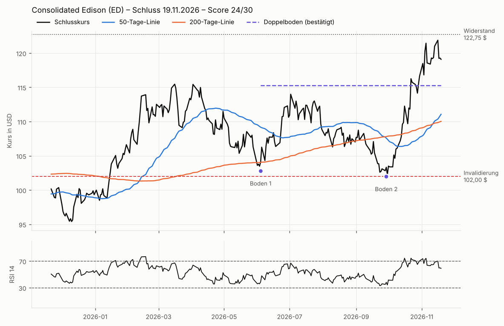
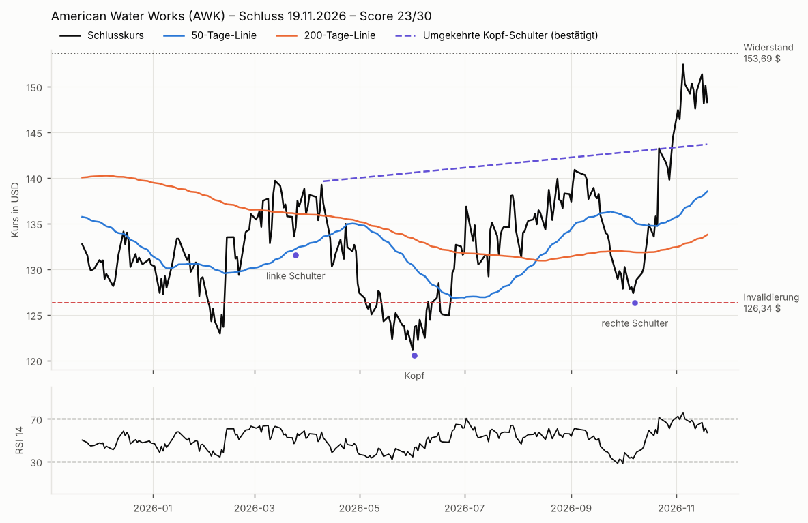
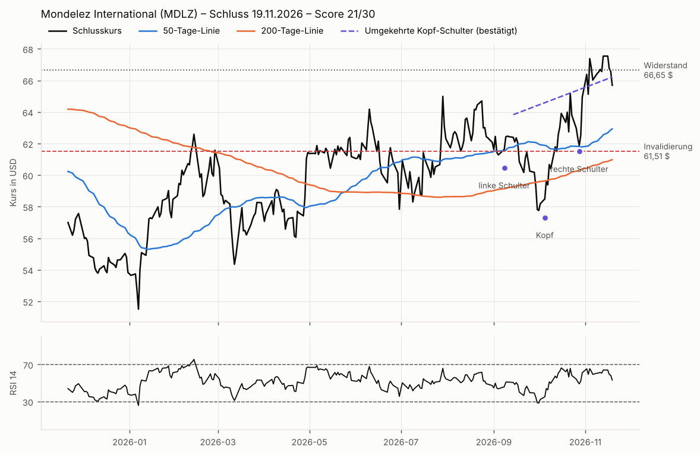
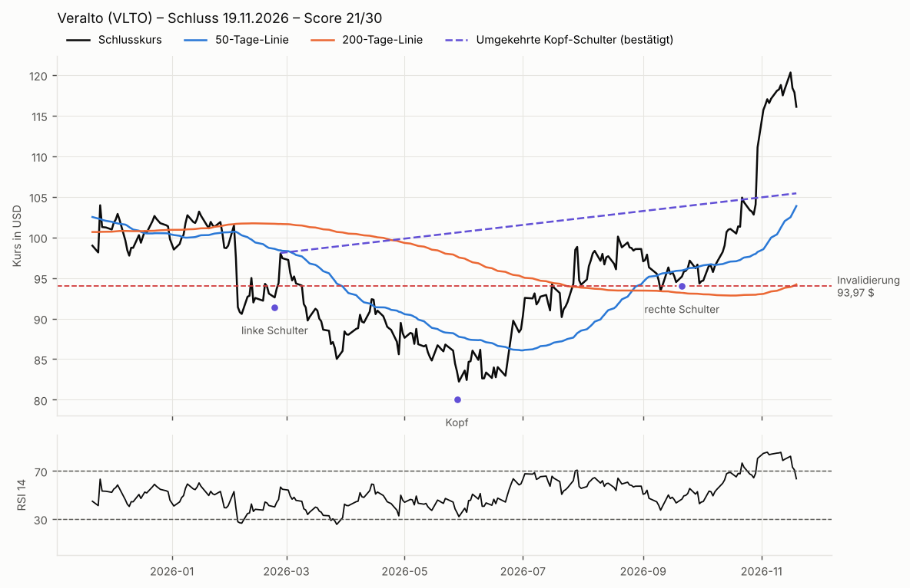
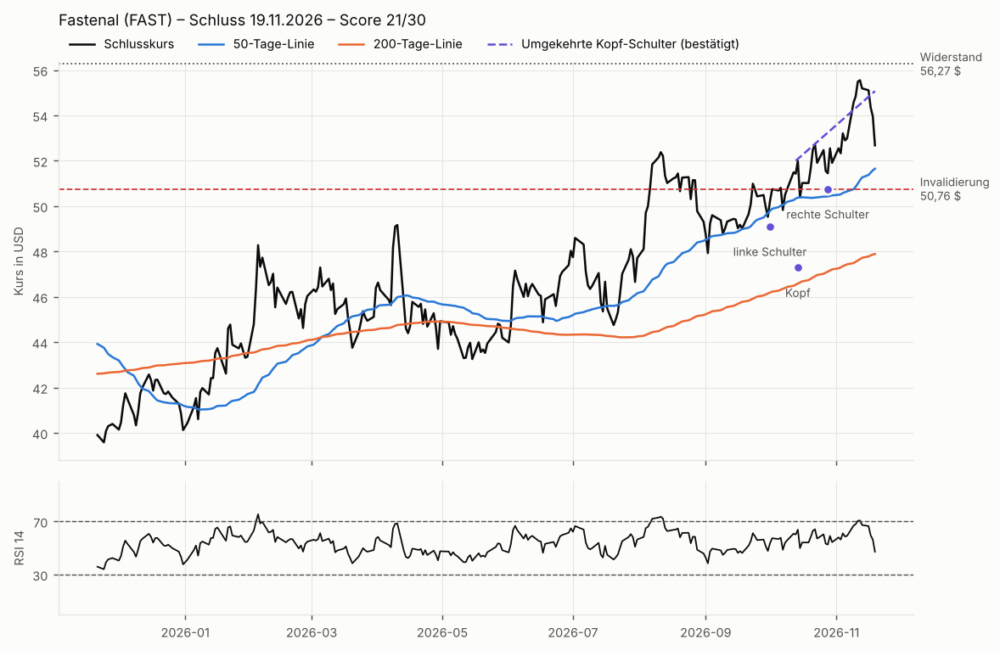
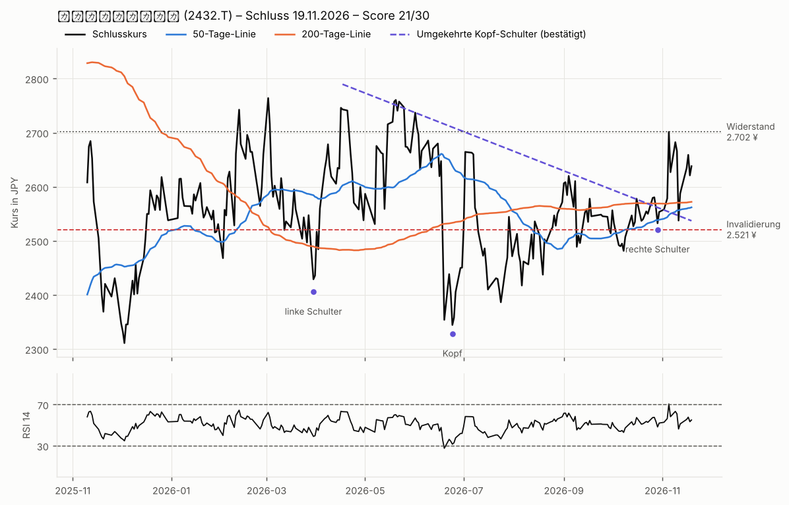
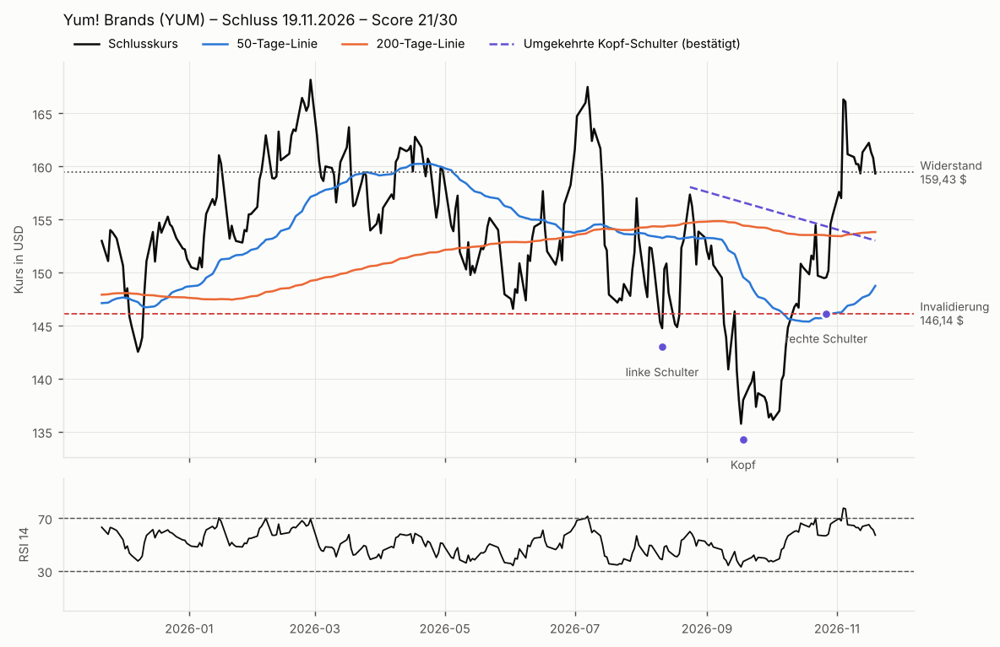

# Aktien-Screener – 20.11.2026

Ausbaustufe 1: Score aus Technik, Muster und Risiko (0–30). Bewertung, Kurstreiber und Erwartungen sind noch nicht enthalten.

**Datenlage**
- Universum: 768 Aktien, nach Filtern 522 (Kurs unter 150 €, Marktkap. ab 1 Mrd. €), bewertet 521
- Kursstand DAX: 20.11.2026
- Kursstand Nikkei 225: 19.11.2026
- Kursstand S&P 500: 19.11.2026
- Wechselkurs: 1 € = 1,0971 USD (Stand 20.11.2026)
- Wechselkurs: 1 € = 174,1740 JPY (Stand 20.11.2026)
- Kurse aus Yahoo Finance können verzögert oder lückenhaft sein.

**Begriffe**
- **RSI (14):** misst, wie stark die Gewinntage der letzten 14 Tage gegenüber den Verlusttagen überwiegen; über 70 überkauft, unter 30 überverkauft.
- **50-/200-Tage-Linie:** Durchschnitt der letzten 50 bzw. 200 Schlusskurse.
- **Golden Cross / Death Cross:** 50-Tage-Linie schneidet die 200-Tage-Linie von unten / von oben.
- **Pp. (Prozentpunkte):** Differenz zweier Prozentwerte, hier Aktie minus Index.
- **Nackenlinie / Ausbruchsmarke:** Linie, deren Durchbruch ein Muster bestätigt.
- **Invalidierung:** Marke, bei deren Unterschreiten die Idee falsch ist.
- **Messziel:** klassische Faustregel (Musterhöhe ab der Nackenlinie), keine Prognose.

## Rangliste (Top 8)

1. **Consolidated Edison** (ED) – 24/30 stark – Aufwärtstrend, Doppelboden (bestätigt)
2. **Evergy** (EVRG) – 23/30 stark – Aufwärtstrend, Umgekehrte Kopf-Schulter (bestätigt)
3. **American Water Works** (AWK) – 23/30 stark – Aufwärtstrend, Umgekehrte Kopf-Schulter (bestätigt)
4. **Mondelez International** (MDLZ) – 21/30 stark – Aufwärtstrend, Umgekehrte Kopf-Schulter (bestätigt)
5. **Veralto** (VLTO) – 21/30 stark – Aufwärtstrend, Umgekehrte Kopf-Schulter (bestätigt)
6. **Fastenal** (FAST) – 21/30 stark – Aufwärtstrend, Umgekehrte Kopf-Schulter (bestätigt)
7. **ディー・エヌ・エー** (2432.T) – 21/30 stark – gemischt, Umgekehrte Kopf-Schulter (bestätigt)
8. **Yum! Brands** (YUM) – 21/30 stark – gemischt, Umgekehrte Kopf-Schulter (bestätigt)

Hohes Potenzial geht fast immer mit hohem Risiko einher. Der Score fasst Indizien zusammen, er ist keine Prognose.

## Ideen

### 1. Consolidated Edison (ED, USA) – Score 24/30
T 9 · M 7 · R 8 · B, K, E: nicht bewertet · **stark**

**Setup:** Aufwärtstrend, RSI 59,2 (neutral). Doppelboden (bestätigt, Sicherheit mittel). Fundamentaldaten noch nicht bewertet.

**Kurs & Trend**
- Kurs: 119,09 $ ≈ 108,54 € (Schluss 19.11.2026)
- 52 Wochen: 87 % der Spanne (94,96 $ bis 122,75 $), -3,0 % zum Hoch
- 50-Tage-Linie 111,06 $ (+7,2 %), 200-Tage-Linie 110,03 $ (+8,2 %) · Golden Cross am 12.11.2026
- RSI (14): 59,2 – neutral
- vs. S&P 500: 1 M +15,3 Pp., 3 M +17,2 Pp., 12 M +10,6 Pp. (Aktie 12 M +18,6 %, Index +8,0 %)
- Volumen: 1,2-fach des 30-Tage-Schnitts

**Muster**
- Doppelboden, **bestätigt**, Erkennungs-Sicherheit mittel
- Nackenlinie: 115,26 $ · Invalidierung: 102,00 $
- bestätigt am 30.10.2026
- erfüllt: Spitzen fast gleich hoch, deutlicher Rücksetzer, ausreichender Abstand

**Invalidierung der Idee:** 102,00 $ (Invalidierung Doppelboden), -14,4 % vom Kurs

**Bewertung:** nicht bewertet (Fundamentaldaten folgen mit dem Modul fundamentals)

**Kurstreiber:** nicht geprüft (Websuche folgt mit /top-aktien)

**Bull-Fall (technisch):** Muster bestätigt. Hält der Kurs über 115,26 $, bleibt das Setup intakt; Faustregel-Messziel 128,11 $.

**Bear-Fall (technisch):** Schlusskurs unter 102,00 $ (Invalidierung Doppelboden): dann ist die Idee falsch.

**Eingepreist?** nicht bewertet

**Gebühr:** 1 Aktie ≈ 108,54 € → 0,99 € entsprechen 0,91 % des Orderbetrags

**Score-Begründung**
- T 9: Kurs über 200-Tage-Linie (+2); Kurs über 50-Tage-Linie (+1); 50- über 200-Tage-Linie (+1); 200-Tage-Linie steigt (+1); frisches Golden Cross (+1); stärker als Index (3 Monate) (+1); stärker als Index (12 Monate) (+1); nahe 52-Wochen-Hoch im Aufwärtstrend (+1)
- M 7: Doppelboden, bestätigt, Sicherheit mittel (+7)
- R 8: Volatilität 19 % p. a. (+4); größter Rückgang 12 Monate 11 % (+2); 0 Tagessprünge > 8 % in 12 Monaten (+2); Abstand zur Invalidierung 14,4 % (+0)

**Quellen:** Kursdaten Yahoo Finance (yfinance), Schluss 19.11.2026; Index S&P 500 Yahoo Finance; Wechselkurs EUR/USD Yahoo Finance

### 2. Evergy (EVRG, USA) – Score 23/30
T 9 · M 4 · R 10 · B, K, E: nicht bewertet · **stark**

**Setup:** Aufwärtstrend, RSI 54,1 (neutral). Umgekehrte Kopf-Schulter (bestätigt, Sicherheit mittel). Fundamentaldaten noch nicht bewertet.

**Kurs & Trend**
- Kurs: 86,47 $ ≈ 78,81 € (Schluss 19.11.2026)
- 52 Wochen: 82 % der Spanne (71,41 $ bis 89,70 $), -3,6 % zum Hoch
- 50-Tage-Linie 82,97 $ (+4,2 %), 200-Tage-Linie 82,82 $ (+4,4 %) · Golden Cross am 17.11.2026
- RSI (14): 54,1 – neutral
- vs. S&P 500: 1 M +12,5 Pp., 3 M +10,4 Pp., 12 M +6,3 Pp. (Aktie 12 M +14,3 %, Index +8,0 %)
- Volumen: 0,8-fach des 30-Tage-Schnitts

**Muster**
- Umgekehrte Kopf-Schulter, **bestätigt**, Erkennungs-Sicherheit mittel
- Nackenlinie: 86,56 $ · Invalidierung: 83,24 $
- bestätigt am 09.11.2026 – Kurs inzwischen wieder jenseits der Marke (Rücklauf)
- erfüllt: Schultern fast gleich hoch, flache Nackenlinie, Kopf deutlich ausgeprägt

**Invalidierung der Idee:** 83,24 $ (Invalidierung Umgekehrte Kopf-Schulter), -3,7 % vom Kurs

**Bewertung:** nicht bewertet (Fundamentaldaten folgen mit dem Modul fundamentals)

**Kurstreiber:** nicht geprüft (Websuche folgt mit /top-aktien)

**Bull-Fall (technisch):** Muster bestätigt, Kurs aber wieder unter 86,56 $ (Rücklauf). Ein erneuter Schlusskurs darüber würde das Setup stützen; Faustregel-Messziel 96,52 $.

**Bear-Fall (technisch):** Schlusskurs unter 83,24 $ (Invalidierung Umgekehrte Kopf-Schulter): dann ist die Idee falsch.

**Eingepreist?** nicht bewertet

**Warnungen**
- Rücklauf: Kurs nach Bestätigung wieder unter der Marke (Umgekehrte Kopf-Schulter)

**Gebühr:** 1 Aktie ≈ 78,81 € → 0,99 € entsprechen 1,26 % des Orderbetrags (hoch – mehrere Stück oder größere Order senken den Anteil)

**Score-Begründung**
- T 9: Kurs über 200-Tage-Linie (+2); Kurs über 50-Tage-Linie (+1); 50- über 200-Tage-Linie (+1); 200-Tage-Linie steigt (+1); frisches Golden Cross (+1); stärker als Index (3 Monate) (+1); stärker als Index (12 Monate) (+1); nahe 52-Wochen-Hoch im Aufwärtstrend (+1)
- M 4: Umgekehrte Kopf-Schulter, bestätigt, Kurs wieder unter der Marke, Sicherheit mittel (+4)
- R 10: Volatilität 15 % p. a. (+4); größter Rückgang 12 Monate 12 % (+2); 0 Tagessprünge > 8 % in 12 Monaten (+2); Abstand zur Invalidierung 3,7 % (+2)

**Quellen:** Kursdaten Yahoo Finance (yfinance), Schluss 19.11.2026; Index S&P 500 Yahoo Finance; Wechselkurs EUR/USD Yahoo Finance

### 3. American Water Works (AWK, USA) – Score 23/30
T 8 · M 7 · R 8 · B, K, E: nicht bewertet · **stark**

**Setup:** Aufwärtstrend, RSI 57,2 (neutral). Umgekehrte Kopf-Schulter (bestätigt, Sicherheit mittel). Fundamentaldaten noch nicht bewertet.

**Kurs & Trend**
- Kurs: 148,28 $ ≈ 135,14 € (Schluss 19.11.2026)
- 52 Wochen: 84 % der Spanne (120,57 $ bis 153,69 $), -3,5 % zum Hoch
- 50-Tage-Linie 138,51 $ (+7,1 %), 200-Tage-Linie 133,77 $ (+10,8 %)
- RSI (14): 57,2 – neutral
- vs. S&P 500: 1 M +17,7 Pp., 3 M +13,8 Pp., 12 M +8,6 Pp. (Aktie 12 M +16,6 %, Index +8,0 %)
- Volumen: 0,9-fach des 30-Tage-Schnitts

**Muster**
- Umgekehrte Kopf-Schulter, **bestätigt**, Erkennungs-Sicherheit mittel
- Nackenlinie: 143,67 $ · Invalidierung: 126,34 $
- bestätigt am 02.11.2026
- erfüllt: flache Nackenlinie, Volumen an der rechten Schulter geringer
- weitere Muster: Doppeltop (gescheitert)

**Invalidierung der Idee:** 126,34 $ (Invalidierung Umgekehrte Kopf-Schulter), -14,8 % vom Kurs

**Bewertung:** nicht bewertet (Fundamentaldaten folgen mit dem Modul fundamentals)

**Kurstreiber:** nicht geprüft (Websuche folgt mit /top-aktien)

**Bull-Fall (technisch):** Muster bestätigt. Hält der Kurs über 143,67 $, bleibt das Setup intakt; Faustregel-Messziel 163,67 $.

**Bear-Fall (technisch):** Schlusskurs unter 126,34 $ (Invalidierung Umgekehrte Kopf-Schulter): dann ist die Idee falsch.

**Eingepreist?** nicht bewertet

**Gebühr:** 1 Aktie ≈ 135,14 € → 0,99 € entsprechen 0,73 % des Orderbetrags

**Score-Begründung**
- T 8: Kurs über 200-Tage-Linie (+2); Kurs über 50-Tage-Linie (+1); 50- über 200-Tage-Linie (+1); 200-Tage-Linie steigt (+1); stärker als Index (3 Monate) (+1); stärker als Index (12 Monate) (+1); nahe 52-Wochen-Hoch im Aufwärtstrend (+1)
- M 7: Umgekehrte Kopf-Schulter, bestätigt, Sicherheit mittel (+7)
- R 8: Volatilität 22 % p. a. (+4); größter Rückgang 12 Monate 13 % (+2); 0 Tagessprünge > 8 % in 12 Monaten (+2); Abstand zur Invalidierung 14,8 % (+0)

**Quellen:** Kursdaten Yahoo Finance (yfinance), Schluss 19.11.2026; Index S&P 500 Yahoo Finance; Wechselkurs EUR/USD Yahoo Finance

### 4. Mondelez International (MDLZ, USA) – Score 21/30
T 8 · M 5 · R 8 · B, K, E: nicht bewertet · **stark**

**Setup:** Aufwärtstrend, RSI 53,2 (neutral). Umgekehrte Kopf-Schulter (bestätigt, Sicherheit hoch). Fundamentaldaten noch nicht bewertet.

**Kurs & Trend**
- Kurs: 65,69 $ ≈ 59,87 € (Schluss 19.11.2026)
- 52 Wochen: 82 % der Spanne (51,20 $ bis 68,92 $), -4,7 % zum Hoch
- 50-Tage-Linie 62,93 $ (+4,4 %), 200-Tage-Linie 60,98 $ (+7,7 %)
- RSI (14): 53,2 – neutral
- vs. S&P 500: 1 M +10,4 Pp., 3 M +9,3 Pp., 12 M +9,1 Pp. (Aktie 12 M +17,1 %, Index +8,0 %)
- Volumen: 1,5-fach des 30-Tage-Schnitts

**Muster**
- Umgekehrte Kopf-Schulter, **bestätigt**, Erkennungs-Sicherheit hoch
- Nackenlinie: 66,21 $ · Invalidierung: 61,51 $
- bestätigt am 02.11.2026 – Kurs inzwischen wieder jenseits der Marke (Rücklauf)
- erfüllt: Schultern fast gleich hoch, zeitlich symmetrisch, flache Nackenlinie, Kopf deutlich ausgeprägt

**Invalidierung der Idee:** 61,51 $ (Invalidierung Umgekehrte Kopf-Schulter), -6,4 % vom Kurs

**Bewertung:** nicht bewertet (Fundamentaldaten folgen mit dem Modul fundamentals)

**Kurstreiber:** nicht geprüft (Websuche folgt mit /top-aktien)

**Bull-Fall (technisch):** Muster bestätigt, Kurs aber wieder unter 66,21 $ (Rücklauf). Ein erneuter Schlusskurs darüber würde das Setup stützen; Faustregel-Messziel 73,47 $.

**Bear-Fall (technisch):** Schlusskurs unter 61,51 $ (Invalidierung Umgekehrte Kopf-Schulter): dann ist die Idee falsch.

**Eingepreist?** nicht bewertet

**Warnungen**
- Rücklauf: Kurs nach Bestätigung wieder unter der Marke (Umgekehrte Kopf-Schulter)

**Gebühr:** 1 Aktie ≈ 59,87 € → 0,99 € entsprechen 1,65 % des Orderbetrags (hoch – mehrere Stück oder größere Order senken den Anteil)

**Score-Begründung**
- T 8: Kurs über 200-Tage-Linie (+2); Kurs über 50-Tage-Linie (+1); 50- über 200-Tage-Linie (+1); 200-Tage-Linie steigt (+1); stärker als Index (3 Monate) (+1); stärker als Index (12 Monate) (+1); nahe 52-Wochen-Hoch im Aufwärtstrend (+1)
- M 5: Umgekehrte Kopf-Schulter, bestätigt, Kurs wieder unter der Marke, Sicherheit hoch (+5)
- R 8: Volatilität 23 % p. a. (+3); größter Rückgang 12 Monate 13 % (+2); 0 Tagessprünge > 8 % in 12 Monaten (+2); Abstand zur Invalidierung 6,4 % (+1)

**Quellen:** Kursdaten Yahoo Finance (yfinance), Schluss 19.11.2026; Index S&P 500 Yahoo Finance; Wechselkurs EUR/USD Yahoo Finance

### 5. Veralto (VLTO, USA) – Score 21/30
T 8 · M 7 · R 6 · B, K, E: nicht bewertet · **stark**

**Setup:** Aufwärtstrend, RSI 63,5 (neutral). Umgekehrte Kopf-Schulter (bestätigt, Sicherheit mittel). Fundamentaldaten noch nicht bewertet.

**Kurs & Trend**
- Kurs: 116,08 $ ≈ 105,80 € (Schluss 19.11.2026)
- 52 Wochen: 89 % der Spanne (80,03 $ bis 120,35 $), -3,5 % zum Hoch
- 50-Tage-Linie 103,86 $ (+11,8 %), 200-Tage-Linie 94,21 $ (+23,2 %)
- RSI (14): 63,5 – neutral
- vs. S&P 500: 1 M +22,2 Pp., 3 M +22,9 Pp., 12 M +10,1 Pp. (Aktie 12 M +18,1 %, Index +8,0 %)
- Volumen: 0,9-fach des 30-Tage-Schnitts

**Muster**
- Umgekehrte Kopf-Schulter, **bestätigt**, Erkennungs-Sicherheit mittel
- Nackenlinie: 105,43 $ · Invalidierung: 93,97 $
- bestätigt am 30.10.2026
- erfüllt: zeitlich symmetrisch, Kopf deutlich ausgeprägt, Volumen an der rechten Schulter geringer

**Invalidierung der Idee:** 93,97 $ (Invalidierung Umgekehrte Kopf-Schulter), -19,0 % vom Kurs

**Bewertung:** nicht bewertet (Fundamentaldaten folgen mit dem Modul fundamentals)

**Kurstreiber:** nicht geprüft (Websuche folgt mit /top-aktien)

**Bull-Fall (technisch):** Muster bestätigt. Hält der Kurs über 105,43 $, bleibt das Setup intakt; Faustregel-Messziel 125,98 $.

**Bear-Fall (technisch):** Schlusskurs unter 93,97 $ (Invalidierung Umgekehrte Kopf-Schulter): dann ist die Idee falsch.

**Eingepreist?** nicht bewertet

**Gebühr:** 1 Aktie ≈ 105,80 € → 0,99 € entsprechen 0,94 % des Orderbetrags

**Score-Begründung**
- T 8: Kurs über 200-Tage-Linie (+2); Kurs über 50-Tage-Linie (+1); 50- über 200-Tage-Linie (+1); 200-Tage-Linie steigt (+1); stärker als Index (3 Monate) (+1); stärker als Index (12 Monate) (+1); nahe 52-Wochen-Hoch im Aufwärtstrend (+1)
- M 7: Umgekehrte Kopf-Schulter, bestätigt, Sicherheit mittel (+7)
- R 6: Volatilität 23 % p. a. (+3); größter Rückgang 12 Monate 21 % (+1); 0 Tagessprünge > 8 % in 12 Monaten (+2); Abstand zur Invalidierung 19,0 % (+0)

**Quellen:** Kursdaten Yahoo Finance (yfinance), Schluss 19.11.2026; Index S&P 500 Yahoo Finance; Wechselkurs EUR/USD Yahoo Finance

### 6. Fastenal (FAST, USA) – Score 21/30
T 7 · M 4 · R 10 · B, K, E: nicht bewertet · **stark**

**Setup:** Aufwärtstrend, RSI 47,2 (neutral). Umgekehrte Kopf-Schulter (bestätigt, Sicherheit mittel). Fundamentaldaten noch nicht bewertet.

**Kurs & Trend**
- Kurs: 52,68 $ ≈ 48,01 € (Schluss 19.11.2026)
- 52 Wochen: 79 % der Spanne (38,97 $ bis 56,27 $), -6,4 % zum Hoch
- 50-Tage-Linie 51,65 $ (+2,0 %), 200-Tage-Linie 47,89 $ (+10,0 %)
- RSI (14): 47,2 – neutral
- vs. S&P 500: 1 M +9,9 Pp., 3 M +9,3 Pp., 12 M +25,2 Pp. (Aktie 12 M +33,2 %, Index +8,0 %)
- Volumen: 0,8-fach des 30-Tage-Schnitts

**Muster**
- Umgekehrte Kopf-Schulter, **bestätigt**, Erkennungs-Sicherheit mittel
- Nackenlinie: 55,07 $ · Invalidierung: 50,76 $
- bestätigt am 10.11.2026 – Kurs inzwischen wieder jenseits der Marke (Rücklauf)
- erfüllt: zeitlich symmetrisch, flache Nackenlinie, Volumen an der rechten Schulter geringer
- weitere Muster: Doppeltop (gescheitert)

**Invalidierung der Idee:** 50,76 $ (Invalidierung Umgekehrte Kopf-Schulter), -3,6 % vom Kurs

**Bewertung:** nicht bewertet (Fundamentaldaten folgen mit dem Modul fundamentals)

**Kurstreiber:** nicht geprüft (Websuche folgt mit /top-aktien)

**Bull-Fall (technisch):** Muster bestätigt, Kurs aber wieder unter 55,07 $ (Rücklauf). Ein erneuter Schlusskurs darüber würde das Setup stützen; Faustregel-Messziel 59,89 $.

**Bear-Fall (technisch):** Schlusskurs unter 50,76 $ (Invalidierung Umgekehrte Kopf-Schulter): dann ist die Idee falsch.

**Eingepreist?** nicht bewertet

**Warnungen**
- Rücklauf: Kurs nach Bestätigung wieder unter der Marke (Umgekehrte Kopf-Schulter)

**Gebühr:** 1 Aktie ≈ 48,01 € → 0,99 € entsprechen 2,06 % des Orderbetrags (hoch – mehrere Stück oder größere Order senken den Anteil)

**Score-Begründung**
- T 7: Kurs über 200-Tage-Linie (+2); Kurs über 50-Tage-Linie (+1); 50- über 200-Tage-Linie (+1); 200-Tage-Linie steigt (+1); stärker als Index (3 Monate) (+1); stärker als Index (12 Monate) (+1)
- M 4: Umgekehrte Kopf-Schulter, bestätigt, Kurs wieder unter der Marke, Sicherheit mittel (+4)
- R 10: Volatilität 20 % p. a. (+4); größter Rückgang 12 Monate 12 % (+2); 0 Tagessprünge > 8 % in 12 Monaten (+2); Abstand zur Invalidierung 3,6 % (+2)

**Quellen:** Kursdaten Yahoo Finance (yfinance), Schluss 19.11.2026; Index S&P 500 Yahoo Finance; Wechselkurs EUR/USD Yahoo Finance

### 7. ディー・エヌ・エー (2432.T, Tokio) – Score 21/30
T 5 · M 7 · R 9 · B, K, E: nicht bewertet · **stark**

**Setup:** gemischt, RSI 55,0 (neutral). Umgekehrte Kopf-Schulter (bestätigt, Sicherheit mittel). Fundamentaldaten noch nicht bewertet.

**Kurs & Trend**
- Kurs: 2.638 ¥ ≈ 15,09 € (Schluss 19.11.2026)
- 52 Wochen: 58 % der Spanne (2.297 ¥ bis 2.885 ¥), -8,6 % zum Hoch
- 50-Tage-Linie 2.562 ¥ (+3,0 %), 200-Tage-Linie 2.572 ¥ (+2,6 %)
- RSI (14): 55,0 – neutral
- vs. Nikkei 225: 1 M +12,4 Pp., 3 M +17,2 Pp., 12 M -12,6 Pp. (Aktie 12 M +9,9 %, Index +22,5 %)
- Volumen: 0,8-fach des 30-Tage-Schnitts

**Muster**
- Umgekehrte Kopf-Schulter, **bestätigt**, Erkennungs-Sicherheit mittel
- Nackenlinie: 2.537 ¥ · Invalidierung: 2.521 ¥
- bestätigt am 05.11.2026
- erfüllt: zeitlich symmetrisch, Volumen an der rechten Schulter geringer
- weitere Muster: Doppeltop (gescheitert), Doppelboden (bestätigt)

**Invalidierung der Idee:** 2.521 ¥ (Invalidierung Umgekehrte Kopf-Schulter), -4,4 % vom Kurs

**Bewertung:** nicht bewertet (Fundamentaldaten folgen mit dem Modul fundamentals)

**Kurstreiber:** nicht geprüft (Websuche folgt mit /top-aktien)

**Bull-Fall (technisch):** Muster bestätigt. Hält der Kurs über 2.537 ¥, bleibt das Setup intakt; Faustregel-Messziel 2.920 ¥.

**Bear-Fall (technisch):** Schlusskurs unter 2.521 ¥ (Invalidierung Umgekehrte Kopf-Schulter): dann ist die Idee falsch.

**Eingepreist?** nicht bewertet

**Gebühr:** 1 Aktie ≈ 15,09 € → 0,99 € entsprechen 6,56 % des Orderbetrags (hoch – mehrere Stück oder größere Order senken den Anteil)

**Score-Begründung**
- T 5: Kurs über 200-Tage-Linie (+2); Kurs über 50-Tage-Linie (+1); 200-Tage-Linie steigt (+1); stärker als Index (3 Monate) (+1)
- M 7: Umgekehrte Kopf-Schulter, bestätigt, Sicherheit mittel (+7)
- R 9: Volatilität 24 % p. a. (+3); größter Rückgang 12 Monate 15 % (+2); 0 Tagessprünge > 8 % in 12 Monaten (+2); Abstand zur Invalidierung 4,4 % (+2)

**Quellen:** Kursdaten Yahoo Finance (yfinance), Schluss 19.11.2026; Index Nikkei 225 Yahoo Finance; Wechselkurs EUR/JPY Yahoo Finance

### 8. Yum! Brands (YUM, USA) – Score 21/30
T 5 · M 9 · R 7 · B, K, E: nicht bewertet · **stark**

**Setup:** gemischt, RSI 57,2 (neutral). Umgekehrte Kopf-Schulter (bestätigt, Sicherheit hoch). Fundamentaldaten noch nicht bewertet.

**Kurs & Trend**
- Kurs: 159,33 $ ≈ 145,21 € (Schluss 19.11.2026)
- 52 Wochen: 70 % der Spanne (134,26 $ bis 170,14 $), -6,4 % zum Hoch
- 50-Tage-Linie 148,74 $ (+7,1 %), 200-Tage-Linie 153,81 $ (+3,6 %)
- RSI (14): 57,2 – neutral
- vs. S&P 500: 1 M +13,0 Pp., 3 M +16,1 Pp., 12 M -0,6 Pp. (Aktie 12 M +7,4 %, Index +8,0 %)
- Volumen: 0,9-fach des 30-Tage-Schnitts

**Muster**
- Umgekehrte Kopf-Schulter, **bestätigt**, Erkennungs-Sicherheit hoch
- Nackenlinie: 153,02 $ · Invalidierung: 146,14 $
- bestätigt am 02.11.2026
- erfüllt: zeitlich symmetrisch, flache Nackenlinie, Kopf deutlich ausgeprägt, Volumen an der rechten Schulter geringer

**Invalidierung der Idee:** 146,14 $ (Invalidierung Umgekehrte Kopf-Schulter), -8,3 % vom Kurs

**Bewertung:** nicht bewertet (Fundamentaldaten folgen mit dem Modul fundamentals)

**Kurstreiber:** nicht geprüft (Websuche folgt mit /top-aktien)

**Bull-Fall (technisch):** Muster bestätigt. Hält der Kurs über 153,02 $, bleibt das Setup intakt; Faustregel-Messziel 175,34 $.

**Bear-Fall (technisch):** Schlusskurs unter 146,14 $ (Invalidierung Umgekehrte Kopf-Schulter): dann ist die Idee falsch.

**Eingepreist?** nicht bewertet

**Gebühr:** 1 Aktie ≈ 145,21 € → 0,99 € entsprechen 0,68 % des Orderbetrags

**Score-Begründung**
- T 5: Kurs über 200-Tage-Linie (+2); Kurs über 50-Tage-Linie (+1); 200-Tage-Linie steigt (+1); stärker als Index (3 Monate) (+1)
- M 9: Umgekehrte Kopf-Schulter, bestätigt, Sicherheit hoch (+9)
- R 7: Volatilität 27 % p. a. (+3); größter Rückgang 12 Monate 19 % (+1); 0 Tagessprünge > 8 % in 12 Monaten (+2); Abstand zur Invalidierung 8,3 % (+1)

**Quellen:** Kursdaten Yahoo Finance (yfinance), Schluss 19.11.2026; Index S&P 500 Yahoo Finance; Wechselkurs EUR/USD Yahoo Finance

## Termine der nächsten Wochen

Noch nicht geprüft – Termine kommen per Websuche mit /top-aktien. Bis dahin vor jedem Kauf den nächsten Zahlentermin selbst prüfen.

---

Recherche-Ideen, keine Anlageberatung – Kurse und Termine vor dem Kauf selbst prüfen.
