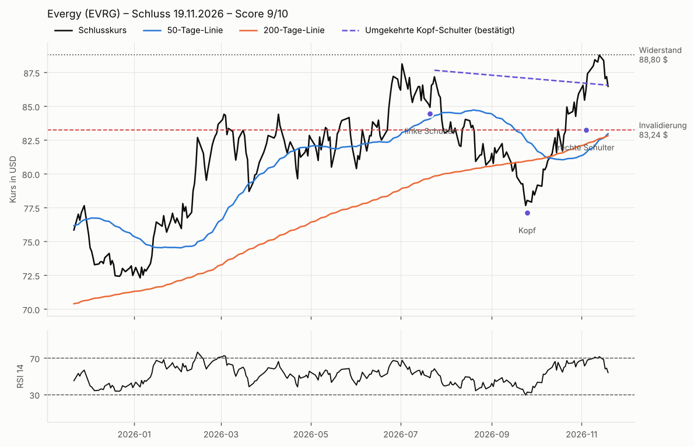
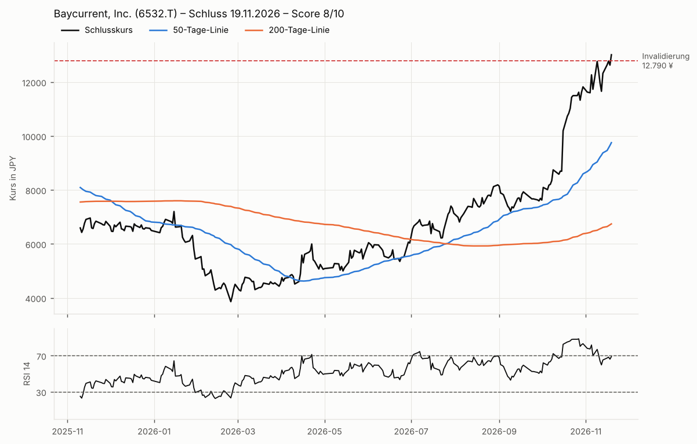
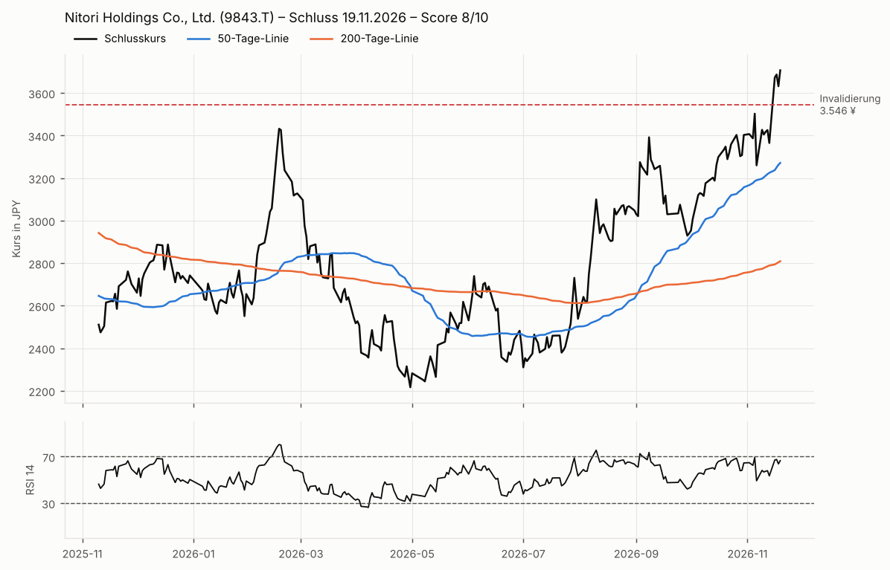
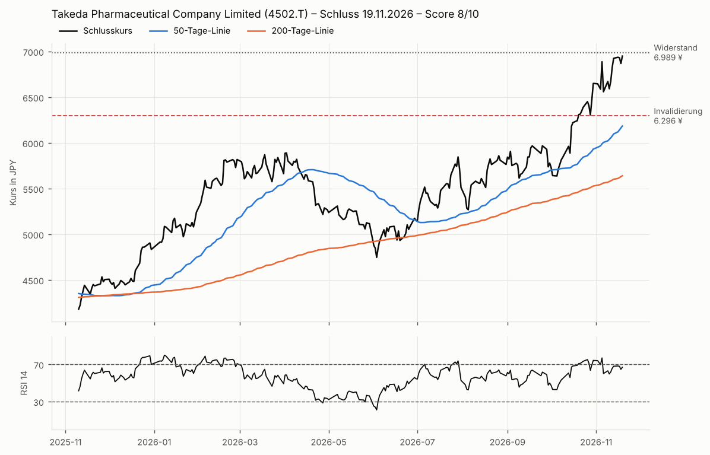
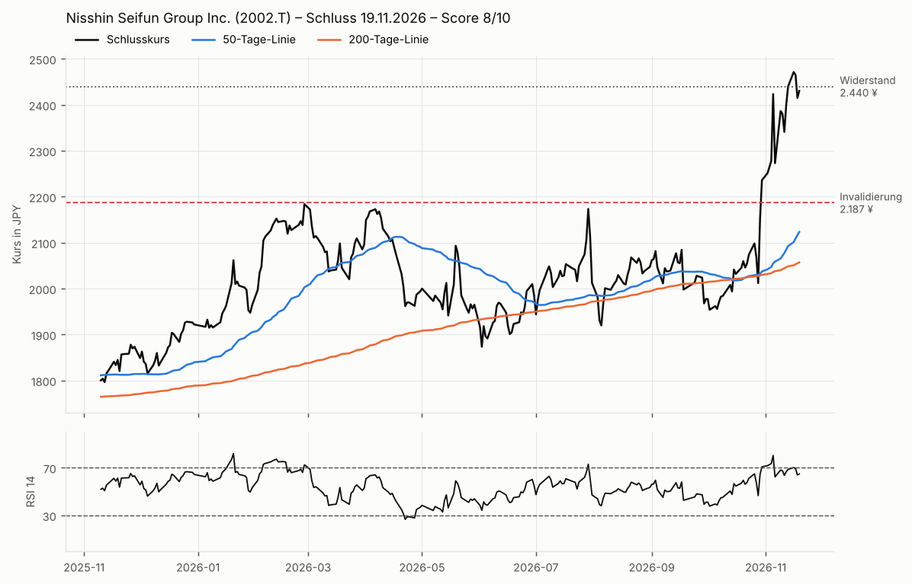
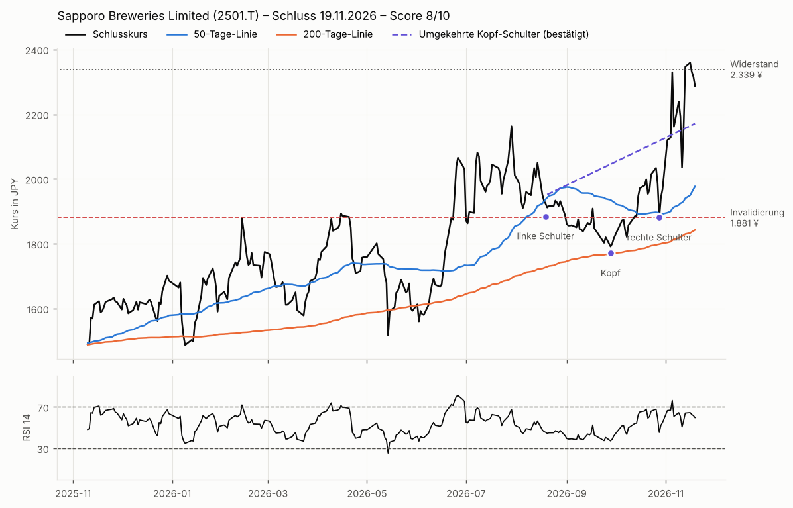
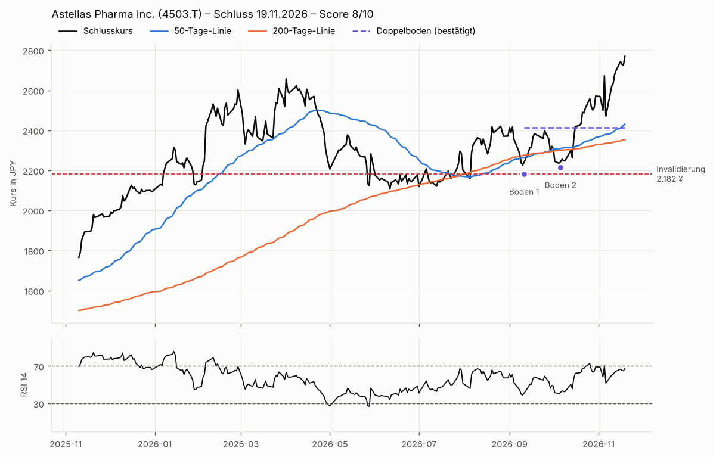

# Aktien-Screener – 20.11.2026

Score 0–10. Gewichte: T 1, M 0, R 0. Bereiche mit Gewicht 0 werden angezeigt, zählen aber nicht. Bewertung, Kurstreiber und Erwartungen sind noch nicht enthalten.

Grund der Gewichtung: Backtest 20.11.2026 (2017–2026): Risiko-Punkte bevorzugten Aktien, die danach zurücklagen (R >= 8: −1,9 Pp. nach 60 Tagen, t −4,7); Muster ohne belastbaren Vorsprung (M > 0: −0,6 Pp., t −2,1). Deshalb vorerst Gewicht 0.

**Datenlage**
- Universum: 768 Aktien, nach Filtern 522 (Kurs unter 150 €, Marktkap. ab 1 Mrd. €), bewertet 521
- Kursstand DAX: 20.11.2026
- Kursstand Nikkei 225: 19.11.2026
- Kursstand S&P 500: 19.11.2026
- Wechselkurs: 1 € = 1,0971 USD (Stand 20.11.2026)
- Wechselkurs: 1 € = 174,1740 JPY (Stand 20.11.2026)
- Kurse aus Yahoo Finance können verzögert oder lückenhaft sein.

**Begriffe**
- **RSI (14):** misst, wie stark die Gewinntage der letzten 14 Tage gegenüber den Verlusttagen überwiegen; über 70 überkauft, unter 30 überverkauft.
- **50-/200-Tage-Linie:** Durchschnitt der letzten 50 bzw. 200 Schlusskurse.
- **Golden Cross / Death Cross:** 50-Tage-Linie schneidet die 200-Tage-Linie von unten / von oben.
- **Pp. (Prozentpunkte):** Differenz zweier Prozentwerte, hier Aktie minus Index.
- **Nackenlinie / Ausbruchsmarke:** Linie, deren Durchbruch ein Muster bestätigt.
- **Invalidierung:** Marke, bei deren Unterschreiten die Idee falsch ist.
- **Messziel:** klassische Faustregel (Musterhöhe ab der Nackenlinie), keine Prognose.

## Rangliste (Top 8)

1. **Consolidated Edison** (ED) – 9/10 stark – Aufwärtstrend, Doppelboden (bestätigt)
2. **Evergy** (EVRG) – 9/10 stark – Aufwärtstrend, Umgekehrte Kopf-Schulter (bestätigt)
3. **Baycurrent, Inc.** (6532.T) – 8/10 stark – Aufwärtstrend, kein Muster
4. **Nitori Holdings Co., Ltd.** (9843.T) – 8/10 stark – Aufwärtstrend, kein Muster
5. **Takeda Pharmaceutical Company Limited** (4502.T) – 8/10 stark – Aufwärtstrend, kein Muster
6. **Nisshin Seifun Group Inc.** (2002.T) – 8/10 stark – Aufwärtstrend, kein Muster
7. **Sapporo Breweries Limited** (2501.T) – 8/10 stark – Aufwärtstrend, Umgekehrte Kopf-Schulter (bestätigt)
8. **Astellas Pharma Inc.** (4503.T) – 8/10 stark – Aufwärtstrend, Doppelboden (bestätigt)

Hohes Potenzial geht fast immer mit hohem Risiko einher. Der Score fasst Indizien zusammen, er ist keine Prognose.

## Ideen

### 1. Consolidated Edison (ED, USA) – Score 9/10
T 9 · M 7 · R 8 · gewertet: T (übrige nur angezeigt) · B, K, E: nicht bewertet · **stark**

**Setup:** Aufwärtstrend, RSI 59,2 (neutral). Doppelboden (bestätigt, Sicherheit mittel). Fundamentaldaten noch nicht bewertet.

**Kurs & Trend**
- Kurs: 119,09 $ ≈ 108,54 € (Schluss 19.11.2026)
- 52 Wochen: 87 % der Spanne (94,96 $ bis 122,75 $), -3,0 % zum Hoch
- 50-Tage-Linie 111,06 $ (+7,2 %), 200-Tage-Linie 110,03 $ (+8,2 %) · Golden Cross am 12.11.2026
- RSI (14): 59,2 – neutral
- vs. S&P 500: 1 M +15,3 Pp., 3 M +17,2 Pp., 12 M +10,6 Pp. (Aktie 12 M +18,6 %, Index +8,0 %)
- Volumen: 1,2-fach des 30-Tage-Schnitts

**Muster**
- Doppelboden, **bestätigt**, Erkennungs-Sicherheit mittel
- Nackenlinie: 115,26 $ · Invalidierung: 102,00 $
- bestätigt am 30.10.2026
- erfüllt: Spitzen fast gleich hoch, deutlicher Rücksetzer, ausreichender Abstand

**Invalidierung der Idee:** 102,00 $ (Invalidierung Doppelboden), -14,4 % vom Kurs

**Bewertung:** nicht bewertet (Fundamentaldaten folgen mit dem Modul fundamentals)

**Kurstreiber:** nicht geprüft (Websuche folgt mit /top-aktien)

**Bull-Fall (technisch):** Muster bestätigt. Hält der Kurs über 115,26 $, bleibt das Setup intakt; Faustregel-Messziel 128,11 $.

**Bear-Fall (technisch):** Schlusskurs unter 102,00 $ (Invalidierung Doppelboden): dann ist die Idee falsch.

**Eingepreist?** nicht bewertet

**Gebühr:** 1 Aktie ≈ 108,54 € → 0,99 € entsprechen 0,91 % des Orderbetrags

**Score-Begründung**
- T 9: Kurs über 200-Tage-Linie (+2); Kurs über 50-Tage-Linie (+1); 50- über 200-Tage-Linie (+1); 200-Tage-Linie steigt (+1); frisches Golden Cross (+1); stärker als Index (3 Monate) (+1); stärker als Index (12 Monate) (+1); nahe 52-Wochen-Hoch im Aufwärtstrend (+1)
- M 7: Doppelboden, bestätigt, Sicherheit mittel (+7)
- R 8: Volatilität 19 % p. a. (+4); größter Rückgang 12 Monate 11 % (+2); 0 Tagessprünge > 8 % in 12 Monaten (+2); Abstand zur Invalidierung 14,4 % (+0)

**Quellen:** Kursdaten Yahoo Finance (yfinance), Schluss 19.11.2026; Index S&P 500 Yahoo Finance; Wechselkurs EUR/USD Yahoo Finance

### 2. Evergy (EVRG, USA) – Score 9/10
T 9 · M 4 · R 10 · gewertet: T (übrige nur angezeigt) · B, K, E: nicht bewertet · **stark**

**Setup:** Aufwärtstrend, RSI 54,1 (neutral). Umgekehrte Kopf-Schulter (bestätigt, Sicherheit mittel). Fundamentaldaten noch nicht bewertet.

**Kurs & Trend**
- Kurs: 86,47 $ ≈ 78,81 € (Schluss 19.11.2026)
- 52 Wochen: 82 % der Spanne (71,41 $ bis 89,70 $), -3,6 % zum Hoch
- 50-Tage-Linie 82,97 $ (+4,2 %), 200-Tage-Linie 82,82 $ (+4,4 %) · Golden Cross am 17.11.2026
- RSI (14): 54,1 – neutral
- vs. S&P 500: 1 M +12,5 Pp., 3 M +10,4 Pp., 12 M +6,3 Pp. (Aktie 12 M +14,3 %, Index +8,0 %)
- Volumen: 0,8-fach des 30-Tage-Schnitts

**Muster**
- Umgekehrte Kopf-Schulter, **bestätigt**, Erkennungs-Sicherheit mittel
- Nackenlinie: 86,56 $ · Invalidierung: 83,24 $
- bestätigt am 09.11.2026 – Kurs inzwischen wieder jenseits der Marke (Rücklauf)
- erfüllt: Schultern fast gleich hoch, flache Nackenlinie, Kopf deutlich ausgeprägt

**Invalidierung der Idee:** 83,24 $ (Invalidierung Umgekehrte Kopf-Schulter), -3,7 % vom Kurs

**Bewertung:** nicht bewertet (Fundamentaldaten folgen mit dem Modul fundamentals)

**Kurstreiber:** nicht geprüft (Websuche folgt mit /top-aktien)

**Bull-Fall (technisch):** Muster bestätigt, Kurs aber wieder unter 86,56 $ (Rücklauf). Ein erneuter Schlusskurs darüber würde das Setup stützen; Faustregel-Messziel 96,52 $.

**Bear-Fall (technisch):** Schlusskurs unter 83,24 $ (Invalidierung Umgekehrte Kopf-Schulter): dann ist die Idee falsch.

**Eingepreist?** nicht bewertet

**Warnungen**
- Rücklauf: Kurs nach Bestätigung wieder unter der Marke (Umgekehrte Kopf-Schulter)

**Gebühr:** 1 Aktie ≈ 78,81 € → 0,99 € entsprechen 1,26 % des Orderbetrags (hoch – mehrere Stück oder größere Order senken den Anteil)

**Score-Begründung**
- T 9: Kurs über 200-Tage-Linie (+2); Kurs über 50-Tage-Linie (+1); 50- über 200-Tage-Linie (+1); 200-Tage-Linie steigt (+1); frisches Golden Cross (+1); stärker als Index (3 Monate) (+1); stärker als Index (12 Monate) (+1); nahe 52-Wochen-Hoch im Aufwärtstrend (+1)
- M 4: Umgekehrte Kopf-Schulter, bestätigt, Kurs wieder unter der Marke, Sicherheit mittel (+4)
- R 10: Volatilität 15 % p. a. (+4); größter Rückgang 12 Monate 12 % (+2); 0 Tagessprünge > 8 % in 12 Monaten (+2); Abstand zur Invalidierung 3,7 % (+2)

**Quellen:** Kursdaten Yahoo Finance (yfinance), Schluss 19.11.2026; Index S&P 500 Yahoo Finance; Wechselkurs EUR/USD Yahoo Finance

### 3. Baycurrent, Inc. (6532.T, Tokio) – Score 8/10
T 8 · M 0 · R 2 · gewertet: T (übrige nur angezeigt) · B, K, E: nicht bewertet · **stark**

**Setup:** Aufwärtstrend, RSI 69,0 (neutral). Kein Chartmuster erkannt. Fundamentaldaten noch nicht bewertet.

**Kurs & Trend**
- Kurs: 13.015 ¥ ≈ 74,43 € (Schluss 19.11.2026)
- 52 Wochen: 99 % der Spanne (3.780 ¥ bis 13.065 ¥), -0,4 % zum Hoch
- 50-Tage-Linie 9.756 ¥ (+33,4 %), 200-Tage-Linie 6.744 ¥ (+93,0 %)
- RSI (14): 69,0 – neutral
- vs. Nikkei 225: 1 M +29,6 Pp., 3 M +84,2 Pp., 12 M +75,5 Pp. (Aktie 12 M +98,0 %, Index +22,5 %)
- Volumen: 0,8-fach des 30-Tage-Schnitts

**Muster**
- kein Muster erkannt

**Invalidierung der Idee:** 12.790 ¥ (nächste Unterstützung), -1,7 % vom Kurs

**Bewertung:** nicht bewertet (Fundamentaldaten folgen mit dem Modul fundamentals)

**Kurstreiber:** nicht geprüft (Websuche folgt mit /top-aktien)

**Bull-Fall (technisch):** Trend setzt sich fort; kein Widerstand im letzten Jahr darüber.

**Bear-Fall (technisch):** Schlusskurs unter 12.790 ¥ (nächste Unterstützung): dann ist die Idee falsch.

**Eingepreist?** nicht bewertet

**Warnungen**
- hohe Volatilität
- häufige große Tagessprünge (binäre Ereignisse?)

**Gebühr:** 1 Aktie ≈ 74,43 € → 0,99 € entsprechen 1,33 % des Orderbetrags (hoch – mehrere Stück oder größere Order senken den Anteil)

**Score-Begründung**
- T 8: Kurs über 200-Tage-Linie (+2); Kurs über 50-Tage-Linie (+1); 50- über 200-Tage-Linie (+1); 200-Tage-Linie steigt (+1); stärker als Index (3 Monate) (+1); stärker als Index (12 Monate) (+1); nahe 52-Wochen-Hoch im Aufwärtstrend (+1)
- M 0: kein bullisches Muster
- R 2: Volatilität 54 % p. a. (+0); größter Rückgang 12 Monate 46 % (+0); 12 Tagessprünge > 8 % in 12 Monaten (+0); Abstand zur Invalidierung 1,7 % (+2)

**Quellen:** Kursdaten Yahoo Finance (yfinance), Schluss 19.11.2026; Index Nikkei 225 Yahoo Finance; Wechselkurs EUR/JPY Yahoo Finance

### 4. Nitori Holdings Co., Ltd. (9843.T, Tokio) – Score 8/10
T 8 · M 0 · R 3 · gewertet: T (übrige nur angezeigt) · B, K, E: nicht bewertet · **stark**

**Setup:** Aufwärtstrend, RSI 66,5 (neutral). Kein Chartmuster erkannt. Fundamentaldaten noch nicht bewertet.

**Kurs & Trend**
- Kurs: 3.707 ¥ ≈ 21,20 € (Schluss 19.11.2026)
- 52 Wochen: 98 % der Spanne (2.216 ¥ bis 3.737 ¥), -0,8 % zum Hoch
- 50-Tage-Linie 3.271 ¥ (+13,3 %), 200-Tage-Linie 2.809 ¥ (+32,0 %)
- RSI (14): 66,5 – neutral
- vs. Nikkei 225: 1 M +19,7 Pp., 3 M +36,5 Pp., 12 M +17,1 Pp. (Aktie 12 M +39,5 %, Index +22,5 %)
- Volumen: 0,8-fach des 30-Tage-Schnitts

**Muster**
- kein Muster erkannt

**Invalidierung der Idee:** 3.546 ¥ (nächste Unterstützung), -4,3 % vom Kurs

**Bewertung:** nicht bewertet (Fundamentaldaten folgen mit dem Modul fundamentals)

**Kurstreiber:** nicht geprüft (Websuche folgt mit /top-aktien)

**Bull-Fall (technisch):** Trend setzt sich fort; kein Widerstand im letzten Jahr darüber.

**Bear-Fall (technisch):** Schlusskurs unter 3.546 ¥ (nächste Unterstützung): dann ist die Idee falsch.

**Eingepreist?** nicht bewertet

**Warnungen**
- häufige große Tagessprünge (binäre Ereignisse?)

**Gebühr:** 1 Aktie ≈ 21,20 € → 0,99 € entsprechen 4,67 % des Orderbetrags (hoch – mehrere Stück oder größere Order senken den Anteil)

**Score-Begründung**
- T 8: Kurs über 200-Tage-Linie (+2); Kurs über 50-Tage-Linie (+1); 50- über 200-Tage-Linie (+1); 200-Tage-Linie steigt (+1); stärker als Index (3 Monate) (+1); stärker als Index (12 Monate) (+1); nahe 52-Wochen-Hoch im Aufwärtstrend (+1)
- M 0: kein bullisches Muster
- R 3: Volatilität 40 % p. a. (+1); größter Rückgang 12 Monate 35 % (+0); 4 Tagessprünge > 8 % in 12 Monaten (+0); Abstand zur Invalidierung 4,3 % (+2)

**Quellen:** Kursdaten Yahoo Finance (yfinance), Schluss 19.11.2026; Index Nikkei 225 Yahoo Finance; Wechselkurs EUR/JPY Yahoo Finance

### 5. Takeda Pharmaceutical Company Limited (4502.T, Tokio) – Score 8/10
T 8 · M 0 · R 7 · gewertet: T (übrige nur angezeigt) · B, K, E: nicht bewertet · **stark**

**Setup:** Aufwärtstrend, RSI 67,0 (neutral). Kein Chartmuster erkannt. Fundamentaldaten noch nicht bewertet.

**Kurs & Trend**
- Kurs: 6.950 ¥ ≈ 39,74 € (Schluss 19.11.2026)
- 52 Wochen: 97 % der Spanne (4.148 ¥ bis 7.037 ¥), -1,2 % zum Hoch
- 50-Tage-Linie 6.185 ¥ (+12,4 %), 200-Tage-Linie 5.640 ¥ (+23,2 %)
- RSI (14): 67,0 – neutral
- vs. Nikkei 225: 1 M +19,7 Pp., 3 M +29,5 Pp., 12 M +35,1 Pp. (Aktie 12 M +57,6 %, Index +22,5 %)
- Volumen: 1,2-fach des 30-Tage-Schnitts

**Muster**
- kein Muster erkannt

**Invalidierung der Idee:** 6.296 ¥ (nächste Unterstützung), -9,4 % vom Kurs

**Bewertung:** nicht bewertet (Fundamentaldaten folgen mit dem Modul fundamentals)

**Kurstreiber:** nicht geprüft (Websuche folgt mit /top-aktien)

**Bull-Fall (technisch):** Trend setzt sich fort; nächster Widerstand bei 6.989 ¥.

**Bear-Fall (technisch):** Schlusskurs unter 6.296 ¥ (nächste Unterstützung): dann ist die Idee falsch.

**Eingepreist?** nicht bewertet

**Gebühr:** 1 Aktie ≈ 39,74 € → 0,99 € entsprechen 2,49 % des Orderbetrags (hoch – mehrere Stück oder größere Order senken den Anteil)

**Score-Begründung**
- T 8: Kurs über 200-Tage-Linie (+2); Kurs über 50-Tage-Linie (+1); 50- über 200-Tage-Linie (+1); 200-Tage-Linie steigt (+1); stärker als Index (3 Monate) (+1); stärker als Index (12 Monate) (+1); nahe 52-Wochen-Hoch im Aufwärtstrend (+1)
- M 0: kein bullisches Muster
- R 7: Volatilität 26 % p. a. (+3); größter Rückgang 12 Monate 19 % (+1); 0 Tagessprünge > 8 % in 12 Monaten (+2); Abstand zur Invalidierung 9,4 % (+1)

**Quellen:** Kursdaten Yahoo Finance (yfinance), Schluss 19.11.2026; Index Nikkei 225 Yahoo Finance; Wechselkurs EUR/JPY Yahoo Finance

### 6. Nisshin Seifun Group Inc. (2002.T, Tokio) – Score 8/10
T 8 · M 0 · R 7 · gewertet: T (übrige nur angezeigt) · B, K, E: nicht bewertet · **stark**

**Setup:** Aufwärtstrend, RSI 64,9 (neutral). Kein Chartmuster erkannt. Fundamentaldaten noch nicht bewertet.

**Kurs & Trend**
- Kurs: 2.430 ¥ ≈ 13,90 € (Schluss 19.11.2026)
- 52 Wochen: 89 % der Spanne (1.768 ¥ bis 2.512 ¥), -3,3 % zum Hoch
- 50-Tage-Linie 2.123 ¥ (+14,5 %), 200-Tage-Linie 2.057 ¥ (+18,1 %)
- RSI (14): 64,9 – neutral
- vs. Nikkei 225: 1 M +27,3 Pp., 3 M +28,8 Pp., 12 M +9,3 Pp. (Aktie 12 M +31,7 %, Index +22,5 %)
- Volumen: 1,1-fach des 30-Tage-Schnitts

**Muster**
- kein Muster erkannt

**Invalidierung der Idee:** 2.187 ¥ (nächste Unterstützung), -10,0 % vom Kurs

**Bewertung:** nicht bewertet (Fundamentaldaten folgen mit dem Modul fundamentals)

**Kurstreiber:** nicht geprüft (Websuche folgt mit /top-aktien)

**Bull-Fall (technisch):** Trend setzt sich fort; nächster Widerstand bei 2.440 ¥.

**Bear-Fall (technisch):** Schlusskurs unter 2.187 ¥ (nächste Unterstützung): dann ist die Idee falsch.

**Eingepreist?** nicht bewertet

**Gebühr:** 1 Aktie ≈ 13,90 € → 0,99 € entsprechen 7,12 % des Orderbetrags (hoch – mehrere Stück oder größere Order senken den Anteil)

**Score-Begründung**
- T 8: Kurs über 200-Tage-Linie (+2); Kurs über 50-Tage-Linie (+1); 50- über 200-Tage-Linie (+1); 200-Tage-Linie steigt (+1); stärker als Index (3 Monate) (+1); stärker als Index (12 Monate) (+1); nahe 52-Wochen-Hoch im Aufwärtstrend (+1)
- M 0: kein bullisches Muster
- R 7: Volatilität 33 % p. a. (+2); größter Rückgang 12 Monate 14 % (+2); 0 Tagessprünge > 8 % in 12 Monaten (+2); Abstand zur Invalidierung 10,0 % (+1)

**Quellen:** Kursdaten Yahoo Finance (yfinance), Schluss 19.11.2026; Index Nikkei 225 Yahoo Finance; Wechselkurs EUR/JPY Yahoo Finance

### 7. Sapporo Breweries Limited (2501.T, Tokio) – Score 8/10
T 8 · M 9 · R 1 · gewertet: T (übrige nur angezeigt) · B, K, E: nicht bewertet · **stark**

**Setup:** Aufwärtstrend, RSI 59,7 (neutral). Umgekehrte Kopf-Schulter (bestätigt, Sicherheit hoch). Fundamentaldaten noch nicht bewertet.

**Kurs & Trend**
- Kurs: 2.288 ¥ ≈ 13,08 € (Schluss 19.11.2026)
- 52 Wochen: 90 % der Spanne (1.467 ¥ bis 2.376 ¥), -3,7 % zum Hoch
- 50-Tage-Linie 1.977 ¥ (+15,7 %), 200-Tage-Linie 1.843 ¥ (+24,1 %)
- RSI (14): 59,7 – neutral
- vs. Nikkei 225: 1 M +23,9 Pp., 3 M +27,9 Pp., 12 M +21,1 Pp. (Aktie 12 M +43,6 %, Index +22,5 %)
- Volumen: 0,7-fach des 30-Tage-Schnitts

**Muster**
- Umgekehrte Kopf-Schulter, **bestätigt**, Erkennungs-Sicherheit hoch
- Nackenlinie: 2.171 ¥ · Invalidierung: 1.881 ¥
- bestätigt am 05.11.2026
- erfüllt: Schultern fast gleich hoch, zeitlich symmetrisch, Kopf deutlich ausgeprägt, Volumen an der rechten Schulter geringer

**Invalidierung der Idee:** 1.881 ¥ (Invalidierung Umgekehrte Kopf-Schulter), -17,8 % vom Kurs

**Bewertung:** nicht bewertet (Fundamentaldaten folgen mit dem Modul fundamentals)

**Kurstreiber:** nicht geprüft (Websuche folgt mit /top-aktien)

**Bull-Fall (technisch):** Muster bestätigt. Hält der Kurs über 2.171 ¥, bleibt das Setup intakt; Faustregel-Messziel 2.440 ¥.

**Bear-Fall (technisch):** Schlusskurs unter 1.881 ¥ (Invalidierung Umgekehrte Kopf-Schulter): dann ist die Idee falsch.

**Eingepreist?** nicht bewertet

**Warnungen**
- hohe Volatilität
- häufige große Tagessprünge (binäre Ereignisse?)

**Gebühr:** 1 Aktie ≈ 13,08 € → 0,99 € entsprechen 7,57 % des Orderbetrags (hoch – mehrere Stück oder größere Order senken den Anteil)

**Score-Begründung**
- T 8: Kurs über 200-Tage-Linie (+2); Kurs über 50-Tage-Linie (+1); 50- über 200-Tage-Linie (+1); 200-Tage-Linie steigt (+1); stärker als Index (3 Monate) (+1); stärker als Index (12 Monate) (+1); nahe 52-Wochen-Hoch im Aufwärtstrend (+1)
- M 9: Umgekehrte Kopf-Schulter, bestätigt, Sicherheit hoch (+9)
- R 1: Volatilität 46 % p. a. (+0); größter Rückgang 12 Monate 20 % (+1); 4 Tagessprünge > 8 % in 12 Monaten (+0); Abstand zur Invalidierung 17,8 % (+0)

**Quellen:** Kursdaten Yahoo Finance (yfinance), Schluss 19.11.2026; Index Nikkei 225 Yahoo Finance; Wechselkurs EUR/JPY Yahoo Finance

### 8. Astellas Pharma Inc. (4503.T, Tokio) – Score 8/10
T 8 · M 4 · R 4 · gewertet: T (übrige nur angezeigt) · B, K, E: nicht bewertet · **stark**

**Setup:** Aufwärtstrend, RSI 67,3 (neutral). Doppelboden (bestätigt, Sicherheit niedrig). Fundamentaldaten noch nicht bewertet.

**Kurs & Trend**
- Kurs: 2.770 ¥ ≈ 15,84 € (Schluss 19.11.2026)
- 52 Wochen: 97 % der Spanne (1.688 ¥ bis 2.800 ¥), -1,1 % zum Hoch
- 50-Tage-Linie 2.431 ¥ (+13,9 %), 200-Tage-Linie 2.354 ¥ (+17,6 %)
- RSI (14): 67,3 – neutral
- vs. Nikkei 225: 1 M +22,6 Pp., 3 M +27,5 Pp., 12 M +22,2 Pp. (Aktie 12 M +44,7 %, Index +22,5 %)
- Volumen: 1,1-fach des 30-Tage-Schnitts

**Muster**
- Doppelboden, **bestätigt**, Erkennungs-Sicherheit niedrig
- Nackenlinie: 2.413 ¥ · Invalidierung: 2.182 ¥
- bestätigt am 21.10.2026
- erfüllt: Volumen an der zweiten Spitze geringer
- weitere Muster: Kopf-Schulter (gescheitert), Doppeltop (gescheitert)

**Invalidierung der Idee:** 2.182 ¥ (Invalidierung Doppelboden), -21,2 % vom Kurs

**Bewertung:** nicht bewertet (Fundamentaldaten folgen mit dem Modul fundamentals)

**Kurstreiber:** nicht geprüft (Websuche folgt mit /top-aktien)

**Bull-Fall (technisch):** Muster bestätigt. Hält der Kurs über 2.413 ¥, bleibt das Setup intakt; Faustregel-Messziel 2.627 ¥.

**Bear-Fall (technisch):** Schlusskurs unter 2.182 ¥ (Invalidierung Doppelboden): dann ist die Idee falsch.

**Eingepreist?** nicht bewertet

**Gebühr:** 1 Aktie ≈ 15,84 € → 0,99 € entsprechen 6,25 % des Orderbetrags (hoch – mehrere Stück oder größere Order senken den Anteil)

**Score-Begründung**
- T 8: Kurs über 200-Tage-Linie (+2); Kurs über 50-Tage-Linie (+1); 50- über 200-Tage-Linie (+1); 200-Tage-Linie steigt (+1); stärker als Index (3 Monate) (+1); stärker als Index (12 Monate) (+1); nahe 52-Wochen-Hoch im Aufwärtstrend (+1)
- M 4: Doppelboden, bestätigt, Sicherheit niedrig (+4)
- R 4: Volatilität 33 % p. a. (+2); größter Rückgang 12 Monate 21 % (+1); 1 Tagessprünge > 8 % in 12 Monaten (+1); Abstand zur Invalidierung 21,2 % (+0)

**Quellen:** Kursdaten Yahoo Finance (yfinance), Schluss 19.11.2026; Index Nikkei 225 Yahoo Finance; Wechselkurs EUR/JPY Yahoo Finance

## Termine der nächsten Wochen

Noch nicht geprüft – Termine kommen per Websuche mit /top-aktien. Bis dahin vor jedem Kauf den nächsten Zahlentermin selbst prüfen.

---

Recherche-Ideen, keine Anlageberatung – Kurse und Termine vor dem Kauf selbst prüfen.
