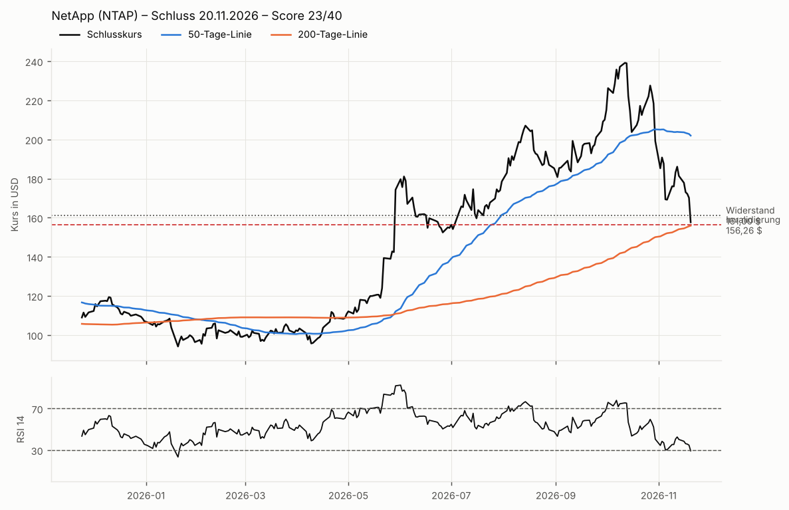
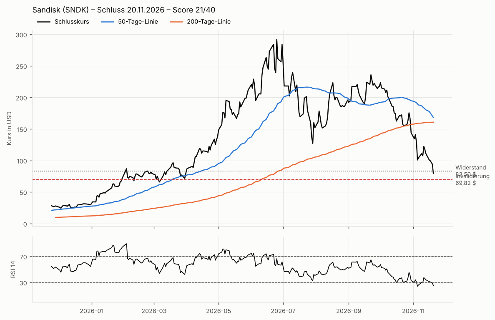
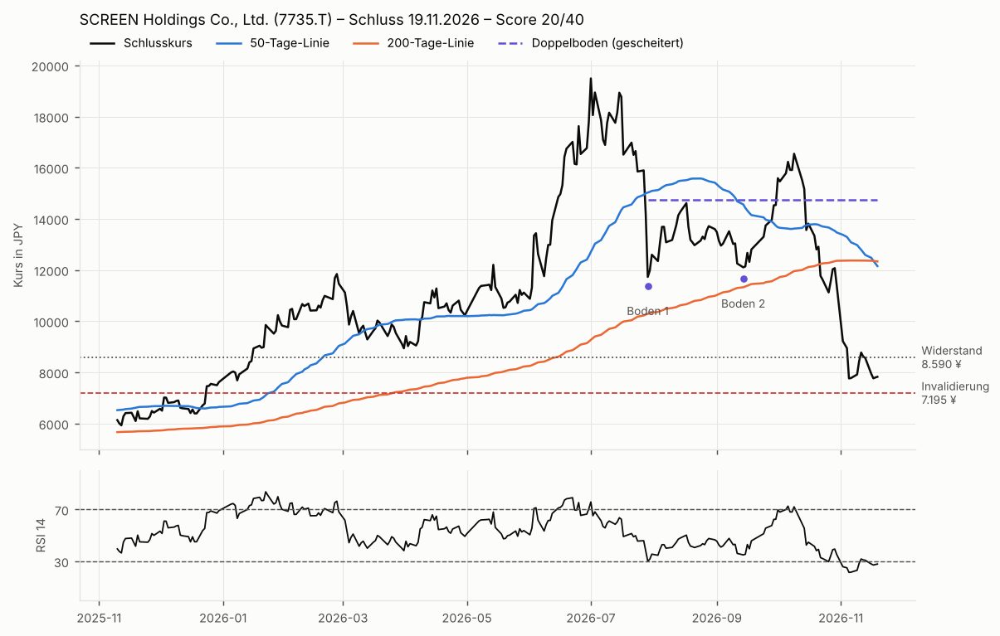
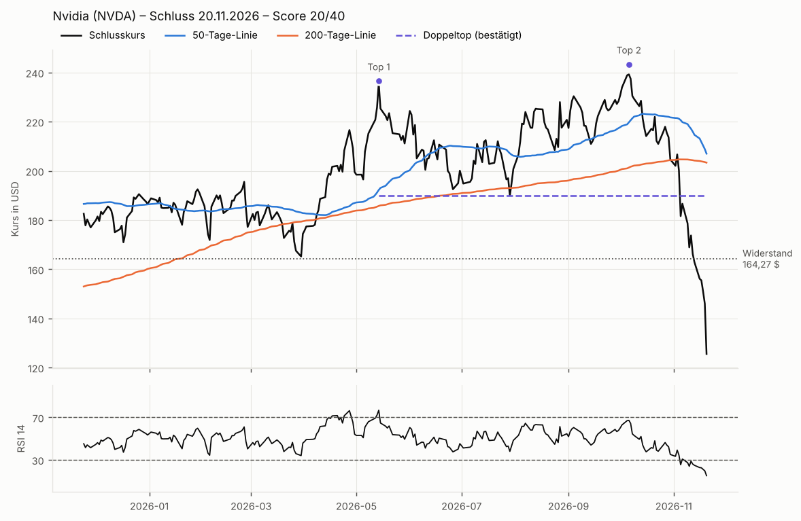
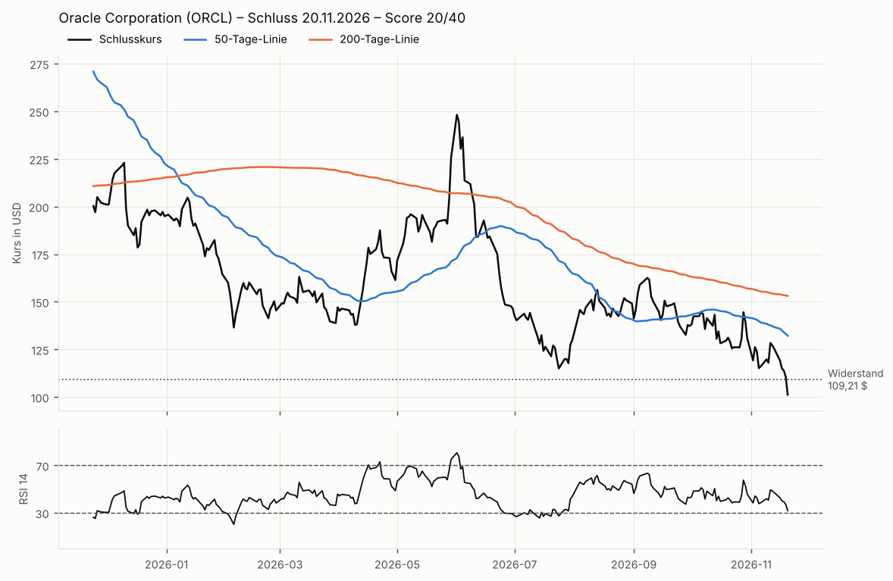
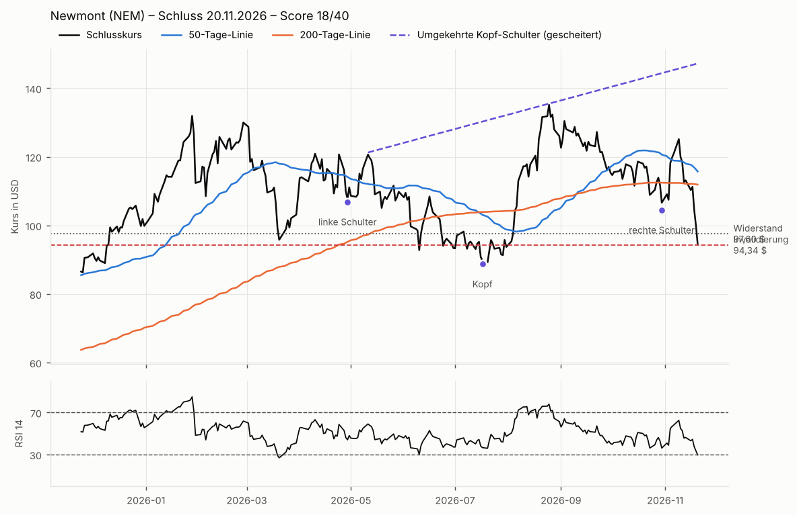
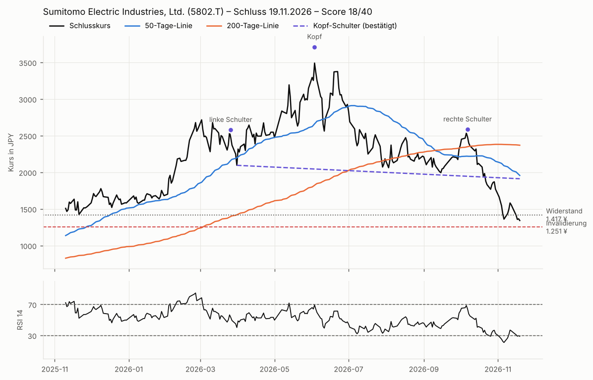
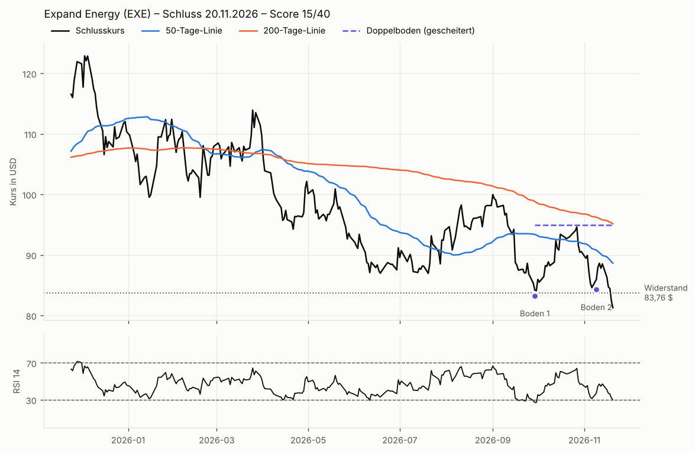
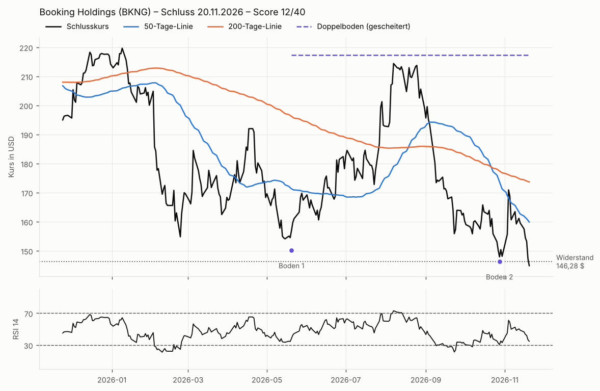
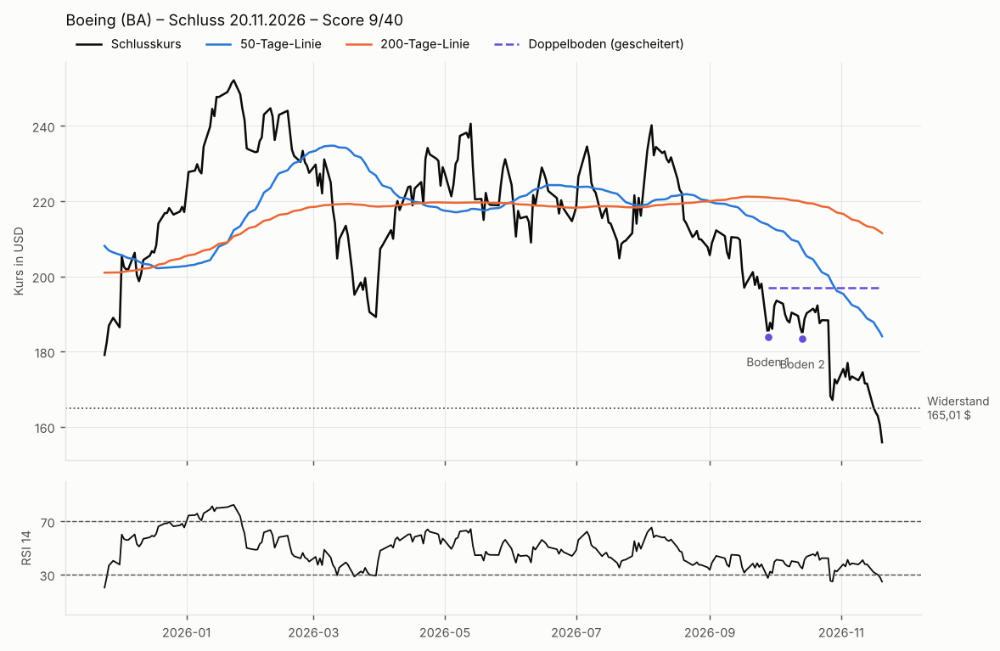

# Rückprall-Kandidaten – 20.11.2026
Auswahl: im letzten Monat mindestens 10 % gefallen, RSI unter 35, profitabel, mindestens 10 Analysten, KGV höchstens 1,2-mal Branchenmedian; je Thema ein Wert (keine Score-Rangliste)

Endbericht mit Websuche (Kurstreiber, Termine, Bull-/Bear-Fall).

Score 0–40. Gewichte: T 1, M 0, R 0, B 1, K 1, E 1. Bereiche mit Gewicht 0 werden angezeigt, zählen aber nicht.

Grund der Gewichtung: Backtest 20.11.2026 (2017–2026): Risiko-Punkte bevorzugten Aktien, die danach zurücklagen (R >= 8: −1,9 Pp. nach 60 Tagen, t −4,7); Muster ohne belastbaren Vorsprung (M > 0: −0,6 Pp., t −2,1). Deshalb vorerst Gewicht 0. B, K, E: Gewicht 1 wie in CLAUDE.md vorgesehen – mangels historischer Fundamentaldaten nicht im Backtest prüfbar; Prüfstein ist das Journal.

**Datenlage**
- Universum: 768 Aktien, nach Filtern 527 (Kurs unter 150 €, Marktkap. ab 1 Mrd. €)
- Vorauswahl: die 10 technisch stärksten; nur sie haben Fundamentaldaten
- Kursstand Nikkei 225: 19.11.2026
- Kursstand S&P 500: 20.11.2026
- Wechselkurs: 1 € = 1,0971 USD (Stand 20.11.2026)
- Wechselkurs: 1 € = 174,1740 JPY (Stand 20.11.2026)
- Kurse und Kennzahlen aus Yahoo Finance können verzögert oder lückenhaft sein.

**Begriffe**
- **RSI (14):** misst, wie stark die Gewinntage der letzten 14 Tage gegenüber den Verlusttagen überwiegen; über 70 überkauft, unter 30 überverkauft.
- **50-/200-Tage-Linie:** Durchschnitt der letzten 50 bzw. 200 Schlusskurse.
- **Golden Cross / Death Cross:** 50-Tage-Linie schneidet die 200-Tage-Linie von unten / von oben.
- **Pp. (Prozentpunkte):** Differenz zweier Prozentwerte, hier Aktie minus Index.
- **KGV:** Kurs-Gewinn-Verhältnis – Kurs geteilt durch den Gewinn je Aktie.
- **EV/EBITDA:** Unternehmenswert (inkl. Schulden) geteilt durch den operativen Gewinn vor Abschreibungen.
- **Nackenlinie / Ausbruchsmarke:** Linie, deren Durchbruch ein Muster bestätigt.
- **Invalidierung:** Marke, bei deren Unterschreiten die Idee falsch ist.
- **Messziel:** klassische Faustregel (Musterhöhe ab der Nackenlinie), keine Prognose.

## Rangliste (Top 10)

1. **NetApp** (NTAP) – 23/40 gemischt – gemischt, Bewertung teuer, kein Muster
2. **Sandisk** (SNDK) – 21/40 gemischt – gemischt, Bewertung günstig, kein Muster
3. **SCREEN Holdings Co., Ltd.** (7735.T) – 20/40 gemischt – Abwärtstrend, Bewertung fair, Doppelboden (gescheitert)
4. **Nvidia** (NVDA) – 20/40 gemischt – gemischt, Bewertung günstig, Doppeltop (bestätigt)
5. **Oracle Corporation** (ORCL) – 20/40 gemischt – Abwärtstrend, Bewertung günstig, kein Muster
6. **Newmont** (NEM) – 18/40 gemischt – gemischt, Bewertung günstig, Umgekehrte Kopf-Schulter (gescheitert)
7. **Sumitomo Electric Industries, Ltd.** (5802.T) – 18/40 gemischt – Abwärtstrend, Bewertung fair, Kopf-Schulter (bestätigt)
8. **Expand Energy** (EXE) – 15/40 schwach – Abwärtstrend, Bewertung teuer, Doppelboden (gescheitert)
9. **Booking Holdings** (BKNG) – 12/40 schwach – Abwärtstrend, Bewertung fair, Doppelboden (gescheitert)
10. **Boeing** (BA) – 9/40 schwach – Abwärtstrend, Bewertung günstig, Doppelboden (gescheitert)

Hohes Potenzial geht fast immer mit hohem Risiko einher. Der Score fasst Indizien zusammen, er ist keine Prognose.

## Ideen

### 1. NetApp (NTAP, USA) – Score 23/40
T 7 · B 3 · K 4 · E 9 (gewertet) · M 0 · R 2 (nur angezeigt) · **gemischt**

**Setup:** gemischt, RSI 29,3 (überverkauft). Kein Chartmuster erkannt. Bewertung teuer (KGV 22,2 vs. Branche 24,1).

**Kurs & Trend**
- Kurs: 157,65 $ ≈ 143,70 € (Schluss 20.11.2026)
- 52 Wochen: 43 % der Spanne (93,69 $ bis 240,87 $), -34,5 % zum Hoch
- 50-Tage-Linie 201,99 $ (-22,0 %), 200-Tage-Linie 155,91 $ (+1,1 %)
- RSI (14): 29,3 – überverkauft
- vs. S&P 500: 1 M -14,5 Pp., 3 M -8,7 Pp., 12 M +47,0 Pp. (Aktie 12 M +52,7 %, Index +5,7 %)
- Volumen: 1,1-fach des 30-Tage-Schnitts

**Muster** (zählt derzeit nicht im Score)
- kein Muster erkannt

**Invalidierung der Idee:** 156,26 $ (nächste Unterstützung), -0,9 % vom Kurs

**Bewertung: teuer** (Kennzahlen Yahoo Finance, Stand 20.11.2026)
- KGV aktuell 22,2, erwartet 14,1
- Branche (Technology, Markt us (35 Werte)): KGV-Median 24,1, EV/EBITDA-Median 16,1
- eigener KGV-Median: 16,6 (4 Geschäftsjahre)
- EV/EBITDA 15,5
- Einordnung: Fair zur Branche (KGV 22,2 vs. 24,1), aber teuer gegenüber der eigenen Historie (Median 16,6); erwartetes KGV 14,1.

**Analysten** (Yahoo Finance)
- Ø-Kursziel 211,69 $ (+34,3 % zum Kurs), Spanne 170,00 $ bis 300,00 $, 16 Analysten
- Gewinnschätzung nächstes Jahr: +11,4 % in 90 Tagen

**Kurstreiber:** Quartalszahlen voraussichtlich am 01.12.2026; Konsens Gewinn je Aktie 2,60 $ (+27 % zum Vorjahr).
- 01.12.2026: Quartalszahlen (laut Zacks erwartet) (Zacks via Yahoo Finance, November 2026)
- Warum bewegt: −25,8 % im Monat bis 09.11. und −9,8 % am 05.11. im Ausverkauf von KI- und Rechenzentrumswerten (Sorge um strengere Regeln für den Rechenzentrumsausbau). Keinen Grund im Unternehmen selbst gefunden – eher vorübergehend, falls die Branchenstimmung dreht.

**Bull-Fall:** Die Zahlen bestätigen das Wachstum; der Kurs liegt als einziger der zehn noch über der 200-Tage-Linie.

**Bear-Fall:** Die Zahlen enttäuschen in einem nervösen Markt. Unterstützung 156,26 $ liegt nur 0,9 % unter dem Kurs – Schlusskurs darunter, Idee falsch.

**Eingepreist?** mittel

**Warnungen**
- hohe Volatilität
- häufige große Tagessprünge (binäre Ereignisse?)

**Gebühr:** 1 Aktie ≈ 143,70 € → 0,99 € entsprechen 0,69 % des Orderbetrags

**Score-Begründung**
- T 7: Kurs über 200-Tage-Linie (+2); 50- über 200-Tage-Linie (+1); 200-Tage-Linie steigt (+1); stärker als Index (12 Monate) (+1); Rücksetzer im langfristigen Trend (RSI < 40, über 200-Tage-Linie) (+2)
- B 3: KGV aktuell 22,2 vs. Branche 24,1 (+2); KGV vs. eigener Median 16,6 (4 Jahre) (+0); EV/EBITDA 15,5 vs. Branche 16,1 (+1)
- K 4: Zahlen am 01.12.2026 laut Zacks erwartet, vom Unternehmen in den Quellen nicht bestätigt.
- E 9: Ø-Kursziel 211,69 (34,3 % Abstand) (+3); Empfehlung Ø 2,3 (1 = Kaufen, 5 = Verkaufen) (+1); Gewinnschätzung nächstes Jahr 11,4 % in 90 Tagen (+3); Revisionen 30 Tage: 1 hoch / 0 runter (+2)
- M 0 (nicht gewertet): kein bullisches Muster
- R 2 (nicht gewertet): Volatilität 55 % p. a. (+0); größter Rückgang 12 Monate 34 % (+0); 6 Tagessprünge > 8 % in 12 Monaten (+0); Abstand zur Invalidierung 0,9 % (+2)

**Quellen:** Kursdaten Yahoo Finance (yfinance), Schluss 20.11.2026; Index S&P 500 Yahoo Finance; Wechselkurs EUR/USD Yahoo Finance; Kennzahlen und Analystendaten Yahoo Finance, Stand 20.11.2026
- GuruFocus, 05.11.2026: Aktie −9,8 % auf 169,38 $
- Trefis, 10.11.2026: −25,8 % im Monat bis 09.11.
- Zacks via Yahoo Finance (November 2026): Zahlen am 01.12.2026 erwartet, EPS-Konsens 2,60 $

### 2. Sandisk (SNDK, USA) – Score 21/40
T 3 · B 7 · K 1 · E 10 (gewertet) · M 0 · R 1 (nur angezeigt) · **gemischt**

**Setup:** gemischt, RSI 25,4 (überverkauft). Kein Chartmuster erkannt. Bewertung günstig (KGV 5,1 vs. Branche 24,1).

**Kurs & Trend**
- Kurs: 79,24 $ ≈ 72,23 € (Schluss 20.11.2026)
- 52 Wochen: 21 % der Spanne (22,88 $ bis 294,30 $), -73,1 % zum Hoch
- 50-Tage-Linie 168,19 $ (-52,9 %), 200-Tage-Linie 160,73 $ (-50,7 %)
- RSI (14): 25,4 – überverkauft
- vs. S&P 500: 1 M -43,2 Pp., 3 M -50,8 Pp., 12 M +217,8 Pp. (Aktie 12 M +223,5 %, Index +5,7 %)
- Volumen: 1,4-fach des 30-Tage-Schnitts

**Muster** (zählt derzeit nicht im Score)
- kein Muster erkannt

**Invalidierung der Idee:** 69,82 $ (nächste Unterstützung), -11,9 % vom Kurs

**Bewertung: günstig** (Kennzahlen Yahoo Finance, Stand 20.11.2026)
- KGV aktuell 5,1, erwartet 2,2
- Branche (Technology, Markt us (35 Werte)): KGV-Median 24,1, EV/EBITDA-Median 16,1
- eigener KGV-Median: 3,9 (1 Geschäftsjahre)
- EV/EBITDA 4,8
- Einordnung: Optisch günstig, wahrscheinlich Zyklus-Hoch der Gewinne – Value-Falle möglich.

**Analysten** (Yahoo Finance)
- Ø-Kursziel 248,16 $ (+213,2 % zum Kurs), Spanne 110,00 $ bis 375,00 $, 24 Analysten
- Gewinnschätzung nächstes Jahr: +8,5 % in 90 Tagen

**Kurstreiber:** Kein fester Termin gefunden; NAND-Preisprognosen sind der Treiber.
- letzter Zahlentermin laut Yahoo: 29.10.2026; nächster nicht gefunden
- Warum bewegt: Am 20.11. rund −14 bis −16 %, nachdem TrendForce ab Q1 2027 fallende NAND-Vertragspreise prognostizierte (Kürzungen chinesischer Cloud-Anbieter); Spotpreise schon über 20 % gefallen. Split 8:1 am 19.11. ist nicht die Ursache. Eher zyklisch-dauerhaft.

**Bull-Fall:** Die NAND-Schwäche fällt milder aus als befürchtet.

**Bear-Fall:** Der Speicherzyklus dreht nach unten; das KGV von 5,1 spiegelt dann Spitzengewinne. Schlusskurs unter 69,82 $ – Idee falsch.

**Eingepreist?** mittel

**Warnungen**
- hohe Volatilität
- häufige große Tagessprünge (binäre Ereignisse?)

**Gebühr:** 1 Aktie ≈ 72,23 € → 0,99 € entsprechen 1,37 % des Orderbetrags (hoch – mehrere Stück oder größere Order senken den Anteil)

**Score-Begründung**
- T 3: 50- über 200-Tage-Linie (+1); 200-Tage-Linie steigt (+1); stärker als Index (12 Monate) (+1)
- B 7: KGV aktuell 5,1 vs. Branche 24,1 (+4); KGV vs. eigener Median 3,9 (1 Jahre, zu kurz – zählt erst ab 3) (+0); EV/EBITDA 4,8 vs. Branche 16,1 (+3)
- K 1: Kein Termin im Fenster gefunden.
- E 10: Ø-Kursziel 248,16 (213,2 % Abstand) (+3); Empfehlung Ø 1,5 (1 = Kaufen, 5 = Verkaufen) (+2); Gewinnschätzung nächstes Jahr 8,5 % in 90 Tagen (+3); Revisionen 30 Tage: 15 hoch / 3 runter (+2)
- M 0 (nicht gewertet): kein bullisches Muster
- R 1 (nicht gewertet): Volatilität 101 % p. a. (+0); größter Rückgang 12 Monate 73 % (+0); 58 Tagessprünge > 8 % in 12 Monaten (+0); Abstand zur Invalidierung 11,9 % (+1)

**Quellen:** Kursdaten Yahoo Finance (yfinance), Schluss 20.11.2026; Index S&P 500 Yahoo Finance; Wechselkurs EUR/USD Yahoo Finance; Kennzahlen und Analystendaten Yahoo Finance, Stand 20.11.2026
- 24/7 Wall St., 20.11.2026: TrendForce sieht 2027 fallende NAND-Preise
- Nacionale (ohne Datum): Split 8:1, Rückgang trotzdem real

### 3. SCREEN Holdings Co., Ltd. (7735.T, Tokio) – Score 20/40
T 1 · B 8 · K 2 · E 9 (gewertet) · M 0 · R 1 (nur angezeigt) · **gemischt**

**Setup:** Abwärtstrend, RSI 27,9 (überverkauft). Doppelboden (gescheitert, Sicherheit mittel). Bewertung fair (KGV 13,8 vs. Branche 20,4).

**Kurs & Trend**
- Kurs: 7.827 ¥ ≈ 44,76 € (Schluss 19.11.2026)
- 52 Wochen: 14 % der Spanne (5.825 ¥ bis 19.770 ¥), -60,4 % zum Hoch
- 50-Tage-Linie 12.154 ¥ (-35,6 %), 200-Tage-Linie 12.337 ¥ (-36,6 %) · Death Cross am 18.11.2026
- RSI (14): 27,9 – überverkauft
- vs. Nikkei 225: 1 M -32,9 Pp., 3 M -31,6 Pp., 12 M +5,9 Pp. (Aktie 12 M +28,4 %, Index +22,5 %)
- Volumen: 0,8-fach des 30-Tage-Schnitts

**Muster** (zählt derzeit nicht im Score)
- Doppelboden, **gescheitert**, Erkennungs-Sicherheit mittel
- Nackenlinie: 14.730 ¥ · Invalidierung: 11.370 ¥
- bestätigt am 01.10.2026
- gescheitert am 26.10.2026
- erfüllt: deutlicher Rücksetzer, ausreichender Abstand, Volumen an der zweiten Spitze geringer

**Invalidierung der Idee:** 7.195 ¥ (nächste Unterstützung), -8,1 % vom Kurs

**Bewertung: fair** (Kennzahlen Yahoo Finance, Stand 20.11.2026)
- KGV aktuell 13,8, erwartet 9,2
- Branche (Technology, Markt jp (25 Werte)): KGV-Median 20,4, EV/EBITDA-Median 10,3
- eigener KGV-Median: 14,1 (4 Geschäftsjahre)
- EV/EBITDA 7,9
- Einordnung: Günstig im Branchenvergleich (KGV 13,8 vs. 20,4), aber zyklisch.

**Analysten** (Yahoo Finance)
- Ø-Kursziel 15.638 ¥ (+99,8 % zum Kurs), Spanne 8.600 ¥ bis 25.000 ¥, 16 Analysten
- Gewinnschätzung nächstes Jahr: +6,1 % in 90 Tagen

**Kurstreiber:** Kein fester Termin gefunden. Rekord-Auftragseingang, Jahresprognose unverändert.
- 17.12.2026: Bank of Japan, Zinsentscheid (17./18.12.; Anhebung erwartet) (Reuters-Umfrage via KFGO, 18.11.2026)
- Warum bewegt: Q2-Umsatz +34 %, aber knapp unter der eigenen Planung; die Jahresprognose wurde trotz Rekordaufträgen nicht angehoben, der Konsens lag darüber. Dazu Goldman-Sachs-Einstufung „Sell“ und Abverkauf japanischer Chipwerte.

**Bull-Fall:** Rekordaufträge setzen sich in Umsatz um; eine spätere Prognoseanhebung könnte den Abschlag auflösen.

**Bear-Fall:** Die Chip-Investitionen kühlen ab und der Branchenabverkauf hält an. Schlusskurs unter 7.195 ¥ – Idee falsch.

**Eingepreist?** mittel

**Warnungen**
- überverkaufter RSI im Abwärtstrend: Warnzeichen, kein Kaufsignal
- frisches Death Cross
- hohe Volatilität
- häufige große Tagessprünge (binäre Ereignisse?)

**Gebühr:** 1 Aktie ≈ 44,76 € → 0,99 € entsprechen 2,21 % des Orderbetrags (hoch – mehrere Stück oder größere Order senken den Anteil)

**Score-Begründung**
- T 1: 200-Tage-Linie steigt (+1); frisches Death Cross (-1); stärker als Index (12 Monate) (+1)
- B 8: KGV aktuell 13,8 vs. Branche 20,4 (+4); KGV vs. eigener Median 14,1 (4 Jahre) (+2); EV/EBITDA 7,9 vs. Branche 10,3 (+2)
- K 2: Kein eigener Termin im Fenster gefunden; nur der BoJ-Zinsentscheid (indirekt).
- E 9: Ø-Kursziel 15637,50 (99,8 % Abstand) (+3); Empfehlung Ø 2,2 (1 = Kaufen, 5 = Verkaufen) (+1); Gewinnschätzung nächstes Jahr 6,1 % in 90 Tagen (+3); Revisionen 30 Tage: 3 hoch / 0 runter (+2)
- M 0 (nicht gewertet): kein bullisches Muster
- R 1 (nicht gewertet): Volatilität 76 % p. a. (+0); größter Rückgang 12 Monate 60 % (+0); 16 Tagessprünge > 8 % in 12 Monaten (+0); Abstand zur Invalidierung 8,1 % (+1)

**Quellen:** Kursdaten Yahoo Finance (yfinance), Schluss 19.11.2026; Index Nikkei 225 Yahoo Finance; Wechselkurs EUR/JPY Yahoo Finance; Kennzahlen und Analystendaten Yahoo Finance, Stand 20.11.2026
- Investing.com (ohne Datum, Anfang Nov. 2026): Jahresprognose nach Q2 bestätigt, Aktie nachbörslich −5,8 %
- Morningstar, 12.11.2026: Kurs 8.619 ¥

### 4. Nvidia (NVDA, USA) – Score 20/40
T 1 · B 9 · K 1 · E 9 (gewertet) · M 0 · R 1 (nur angezeigt) · **gemischt**

**Setup:** gemischt, RSI 15,0 (überverkauft). Doppeltop (bestätigt, Sicherheit mittel). Bewertung günstig (KGV 13,5 vs. Branche 24,1).

**Kurs & Trend**
- Kurs: 125,53 $ ≈ 114,42 € (Schluss 20.11.2026)
- 52 Wochen: 1 % der Spanne (124,50 $ bis 243,37 $), -48,4 % zum Hoch
- 50-Tage-Linie 207,00 $ (-39,4 %), 200-Tage-Linie 203,35 $ (-38,3 %)
- RSI (14): 15,0 – überverkauft
- vs. S&P 500: 1 M -31,6 Pp., 3 M -32,5 Pp., 12 M -36,2 Pp. (Aktie 12 M -30,5 %, Index +5,7 %)
- Volumen: 3,0-fach des 30-Tage-Schnitts – auffällig

**Muster** (zählt derzeit nicht im Score)
- Doppeltop, **bestätigt**, Erkennungs-Sicherheit mittel
- Nackenlinie: 189,80 $ · Invalidierung: 243,37 $
- bestätigt am 05.11.2026
- erfüllt: deutlicher Rücksetzer, ausreichender Abstand, Volumen an der zweiten Spitze geringer

**Invalidierung der Idee:** nicht gefunden (nicht gefunden), Abstand nicht gefunden vom Kurs

**Bewertung: günstig** (Kennzahlen Yahoo Finance, Stand 20.11.2026)
- KGV aktuell 13,5, erwartet 7,6
- Branche (Technology, Markt us (35 Werte)): KGV-Median 24,1, EV/EBITDA-Median 16,1
- eigener KGV-Median: 46,3 (4 Geschäftsjahre)
- EV/EBITDA 14,2
- Einordnung: Nach KGV günstig, aber mit hohem Sonderrisiko.

**Analysten** (Yahoo Finance)
- Ø-Kursziel 244,18 $ (+94,5 % zum Kurs), Spanne 130,00 $ bis 425,00 $, 56 Analysten
- Gewinnschätzung nächstes Jahr: +27,7 % in 90 Tagen

**Kurstreiber:** Laut WSJ/Reuters zivilrechtliche SEC-Untersuchung zu Offenlegung bzw. Bilanzierung (offiziell nicht bestätigt). Suche nach einem neuen CEO nach dem Rücktritt von Jensen Huang.
- letzter Zahlentermin laut Yahoo: 17.11.2026; nächster nicht gefunden
- Warum bewegt: Huang trat als CEO zurück; Berichte über die SEC-Untersuchung; am 20.11. rund −14 % auf ein 52-Wochen-Tief, obwohl das Quartal stark war und der Ausblick positiv. Ob dauerhaft, hängt am Ausgang der Untersuchung.

**Bull-Fall:** Die Untersuchung endet ohne Folgen und ein neuer CEO wird benannt; das Geschäft lief zuletzt stark (KGV 13,5 vs. 24,1).

**Bear-Fall:** Die Untersuchung führt zu Korrekturen oder Strafen. Die Aktie steht am 52-Wochen-Tief – ein neues Tief heißt, die Idee ist falsch.

**Eingepreist?** mittel

**Warnungen**
- bärisches Muster: Doppeltop (bestätigt)
- hohe Volatilität

**Gebühr:** 1 Aktie ≈ 114,42 € → 0,99 € entsprechen 0,87 % des Orderbetrags

**Score-Begründung**
- T 1: 50- über 200-Tage-Linie (+1)
- B 9: KGV aktuell 13,5 vs. Branche 24,1 (+4); KGV vs. eigener Median 46,3 (4 Jahre) (+3); EV/EBITDA 14,2 vs. Branche 16,1 (+2)
- K 1: Kein Termin im Fenster; die SEC-Untersuchung ist ein binäres Ereignis ohne Datum.
- E 9: Ø-Kursziel 244,18 (94,5 % Abstand) (+3); Empfehlung Ø 1,8 (1 = Kaufen, 5 = Verkaufen) (+1); Gewinnschätzung nächstes Jahr 27,7 % in 90 Tagen (+3); Revisionen 30 Tage: 7 hoch / 0 runter (+2)
- M 0 (nicht gewertet): Abzug für bärisches Muster (−4)
- R 1 (nicht gewertet): Volatilität 50 % p. a. (+0); größter Rückgang 12 Monate 48 % (+0); 3 Tagessprünge > 8 % in 12 Monaten (+1); Abstand zur Invalidierung nicht gefunden (+0)

**Quellen:** Kursdaten Yahoo Finance (yfinance), Schluss 20.11.2026; Index S&P 500 Yahoo Finance; Wechselkurs EUR/USD Yahoo Finance; Kennzahlen und Analystendaten Yahoo Finance, Stand 20.11.2026
- TechCrunch, 17.11.2026: SEC untersucht Nvidia nach Huangs Rücktritt (Bericht)
- Axios, 17.11.2026: starke Zahlen trotz Huang-Rücktritt und SEC-Bericht
- Decrypt (ohne Datum): Aktie auf 52-Wochen-Tief

### 5. Oracle Corporation (ORCL, USA) – Score 20/40
T 0 · B 9 · K 2 · E 9 (gewertet) · M 0 · R 0 (nur angezeigt) · **gemischt**

**Setup:** Abwärtstrend, RSI 31,8 (neutral). Kein Chartmuster erkannt. Bewertung günstig (KGV 15,9 vs. Branche 24,1).

**Kurs & Trend**
- Kurs: 101,19 $ ≈ 92,23 € (Schluss 20.11.2026)
- 52 Wochen: 1 % der Spanne (100,25 $ bis 250,25 $), -59,6 % zum Hoch
- 50-Tage-Linie 132,14 $ (-23,4 %), 200-Tage-Linie 153,10 $ (-33,9 %)
- RSI (14): 31,8 – neutral
- vs. S&P 500: 1 M -12,4 Pp., 3 M -19,2 Pp., 12 M -57,7 Pp. (Aktie 12 M -52,0 %, Index +5,7 %)
- Volumen: 1,2-fach des 30-Tage-Schnitts

**Muster** (zählt derzeit nicht im Score)
- kein Muster erkannt

**Invalidierung der Idee:** nicht gefunden (nicht gefunden), Abstand nicht gefunden vom Kurs

**Bewertung: günstig** (Kennzahlen Yahoo Finance, Stand 20.11.2026)
- KGV aktuell 15,9, erwartet 9,2
- Branche (Technology, Markt us (35 Werte)): KGV-Median 24,1, EV/EBITDA-Median 16,1
- eigener KGV-Median: 36,3 (4 Geschäftsjahre)
- EV/EBITDA 13,7
- Einordnung: Nach KGV günstig (15,9 vs. 24,1), aber hohe Verschuldung.

**Analysten** (Yahoo Finance)
- Ø-Kursziel 236,18 $ (+133,4 % zum Kurs), Spanne 110,00 $ bis 400,00 $, 40 Analysten
- Gewinnschätzung nächstes Jahr: +1,3 % in 90 Tagen

**Kurstreiber:** Kein bestätigter Termin gefunden. Thema ist die Finanzierung des KI-Rechenzentrumsausbaus.
- Zahlentermin laut Yahoo (ungeprüft): 14.12.2026
- Warum bewegt: Kapitalerhöhung über 20 Mrd. $ am 02.11. (davon 10 Mrd. $ Aktien, verwässernd), Aktie −9 %; negativer freier Cashflow (−5,4 Mrd. $ im letzten Quartal), Rating BBB−, hohe Abhängigkeit von OpenAI. Eher strukturell als vorübergehend.

**Bull-Fall:** Der Investitionsgipfel wird wie angekündigt FY27–28 erreicht; Bernstein sieht selbst im Stressfall rund 133 $.

**Bear-Fall:** Rating-Herabstufung unter Investment Grade oder Probleme bei OpenAI. 52-Wochen-Tief – ein neues Tief heißt, die Idee ist falsch.

**Eingepreist?** mittel

**Warnungen**
- hohe Volatilität
- häufige große Tagessprünge (binäre Ereignisse?)
- Vorsicht Value-Falle: günstig, aber Abwärtstrend

**Gebühr:** 1 Aktie ≈ 92,23 € → 0,99 € entsprechen 1,07 % des Orderbetrags (hoch – mehrere Stück oder größere Order senken den Anteil)

**Score-Begründung**
- T 0: keine Punkte
- B 9: KGV aktuell 15,9 vs. Branche 24,1 (+4); KGV vs. eigener Median 36,3 (4 Jahre) (+3); EV/EBITDA 13,7 vs. Branche 16,1 (+2)
- K 2: Kein bestätigter Termin im Fenster gefunden.
- E 9: Ø-Kursziel 236,18 (133,4 % Abstand) (+3); Empfehlung Ø 1,5 (1 = Kaufen, 5 = Verkaufen) (+2); Gewinnschätzung nächstes Jahr 1,3 % in 90 Tagen (+2); Revisionen 30 Tage: 8 hoch / 7 runter (+2)
- M 0 (nicht gewertet): kein bullisches Muster
- R 0 (nicht gewertet): Volatilität 65 % p. a. (+0); größter Rückgang 12 Monate 59 % (+0); 15 Tagessprünge > 8 % in 12 Monaten (+0); Abstand zur Invalidierung nicht gefunden (+0)

**Quellen:** Kursdaten Yahoo Finance (yfinance), Schluss 20.11.2026; Index S&P 500 Yahoo Finance; Wechselkurs EUR/USD Yahoo Finance; Kennzahlen und Analystendaten Yahoo Finance, Stand 20.11.2026
- Business Chief (ohne Datum): −8,8 % nach Kapitalerhöhung über 20 Mrd. $
- Motley Fool, 16.11.2026: Sorge um OpenAI-Abhängigkeit
- GuruFocus (ohne Datum): Schluss 19.11. bei 110,57 $, Bernstein-Stressfall 133 $

### 6. Newmont (NEM, USA) – Score 18/40
T 2 · B 7 · K 4 · E 5 (gewertet) · M 0 · R 3 (nur angezeigt) · **gemischt**

**Setup:** gemischt, RSI 29,7 (überverkauft). Umgekehrte Kopf-Schulter (gescheitert, Sicherheit mittel). Bewertung günstig (KGV 11,0 vs. Branche 16,6).

**Kurs & Trend**
- Kurs: 94,68 $ ≈ 86,30 € (Schluss 20.11.2026)
- 52 Wochen: 25 % der Spanne (81,34 $ bis 135,29 $), -30,0 % zum Hoch
- 50-Tage-Linie 115,72 $ (-18,2 %), 200-Tage-Linie 111,91 $ (-15,4 %)
- RSI (14): 29,7 – überverkauft
- vs. S&P 500: 1 M -8,5 Pp., 3 M -16,3 Pp., 12 M +9,8 Pp. (Aktie 12 M +15,5 %, Index +5,7 %)
- Volumen: 2,0-fach des 30-Tage-Schnitts

**Muster** (zählt derzeit nicht im Score)
- Umgekehrte Kopf-Schulter, **gescheitert**, Erkennungs-Sicherheit mittel
- Nackenlinie: 147,21 $ · Invalidierung: 104,51 $
- gescheitert am 19.11.2026
- erfüllt: zeitlich symmetrisch, Kopf deutlich ausgeprägt, Volumen an der rechten Schulter geringer

**Invalidierung der Idee:** 94,34 $ (nächste Unterstützung), -0,4 % vom Kurs

**Bewertung: günstig** (Kennzahlen Yahoo Finance, Stand 20.11.2026)
- KGV aktuell 11,0, erwartet 9,5
- Branche (Basic Materials, Markt us (9 Werte)): KGV-Median 16,6, EV/EBITDA-Median 8,9
- eigener KGV-Median: 14,2 (2 Geschäftsjahre)
- EV/EBITDA 5,7
- Einordnung: Günstig im Branchenvergleich (KGV 11,0 vs. 16,6), abhängig vom Goldpreis.

**Analysten** (Yahoo Finance)
- Ø-Kursziel 134,57 $ (+42,1 % zum Kurs), Spanne 70,00 $ bis 165,00 $, 19 Analysten
- Gewinnschätzung nächstes Jahr: -1,1 % in 90 Tagen

**Kurstreiber:** Fed-Zinsentscheid am 09.12.2026; Goldpreis reagiert auf Zinserwartungen und Dollar.
- 09.12.2026: Fed-Zinsentscheid (FOMC 8./9.12.) (Federal Reserve, Kalender Dezember 2026)
- Warum bewegt: Gold fiel auf ein 14-Monats-Tief (Terminkontrakt −3,5 % auf 3.728,80 $ am 18.11.) wegen steigender Zinserwartungen und eines starken Dollars; Newmont am 18.11. −6 bis −8 %. Rohstoffbedingt, kein Firmenproblem.

**Bull-Fall:** Dreht der Goldpreis, hebeln Minenaktien die Bewegung; Q3 mit realisiertem Goldpreis von 4.317 $/Unze.

**Bear-Fall:** Gold fällt weiter, falls die Fed straffer wird. Unterstützung 94,34 $ nur 0,4 % unter dem Kurs – Schlusskurs darunter, Idee falsch.

**Eingepreist?** mittel

**Warnungen**
- häufige große Tagessprünge (binäre Ereignisse?)
- Vorsicht Value-Falle: günstig, aber fallende Gewinnschätzungen
- fallende Gewinnschätzungen

**Gebühr:** 1 Aktie ≈ 86,30 € → 0,99 € entsprechen 1,15 % des Orderbetrags (hoch – mehrere Stück oder größere Order senken den Anteil)

**Score-Begründung**
- T 2: 50- über 200-Tage-Linie (+1); stärker als Index (12 Monate) (+1)
- B 7: KGV aktuell 11,0 vs. Branche 16,6 (+4); KGV vs. eigener Median 14,2 (2 Jahre, zu kurz – zählt erst ab 3) (+0); EV/EBITDA 5,7 vs. Branche 8,9 (+3)
- K 4: Fed-Zinsentscheid am 09.12.2026 mit direktem Bezug zum Goldpreis.
- E 5: Ø-Kursziel 134,57 (42,1 % Abstand) (+3); Empfehlung Ø 1,7 (1 = Kaufen, 5 = Verkaufen) (+2); Gewinnschätzung nächstes Jahr -1,1 % in 90 Tagen (+0); Revisionen 30 Tage: 2 hoch / 10 runter (+0)
- M 0 (nicht gewertet): kein bullisches Muster
- R 3 (nicht gewertet): Volatilität 45 % p. a. (+1); größter Rückgang 12 Monate 32 % (+0); 5 Tagessprünge > 8 % in 12 Monaten (+0); Abstand zur Invalidierung 0,4 % (+2)

**Quellen:** Kursdaten Yahoo Finance (yfinance), Schluss 20.11.2026; Index S&P 500 Yahoo Finance; Wechselkurs EUR/USD Yahoo Finance; Kennzahlen und Analystendaten Yahoo Finance, Stand 20.11.2026
- Kalkine (ohne Datum): Gold auf 14-Monats-Tief, Fed-Erwartungen und Dollar
- GuruFocus (ohne Datum): Newmont −8 % bei Goldschwäche
- TradingKey, 18.11.2026: Newmont −5,89 %

### 7. Sumitomo Electric Industries, Ltd. (5802.T, Tokio) – Score 18/40
T 0 · B 6 · K 2 · E 10 (gewertet) · M 0 · R 1 (nur angezeigt) · **gemischt**

**Setup:** Abwärtstrend, RSI 28,8 (überverkauft). Kopf-Schulter (bestätigt, Sicherheit mittel). Bewertung fair (KGV 13,4 vs. Branche 15,8).

**Kurs & Trend**
- Kurs: 1.342 ¥ ≈ 7,67 € (Schluss 19.11.2026)
- 52 Wochen: 4 % der Spanne (1.251 ¥ bis 3.712 ¥), -63,9 % zum Hoch
- 50-Tage-Linie 1.957 ¥ (-31,4 %), 200-Tage-Linie 2.370 ¥ (-43,4 %)
- RSI (14): 28,8 – überverkauft
- vs. Nikkei 225: 1 M -26,8 Pp., 3 M -30,3 Pp., 12 M -32,2 Pp. (Aktie 12 M -9,7 %, Index +22,5 %)
- Volumen: 0,9-fach des 30-Tage-Schnitts

**Muster** (zählt derzeit nicht im Score)
- Kopf-Schulter, **bestätigt**, Erkennungs-Sicherheit mittel
- Nackenlinie: 1.912 ¥ · Invalidierung: 2.587 ¥
- bestätigt am 22.10.2026
- erfüllt: Schultern fast gleich hoch, Kopf deutlich ausgeprägt, Volumen an der rechten Schulter geringer

**Invalidierung der Idee:** 1.251 ¥ (nächste Unterstützung), -6,7 % vom Kurs

**Bewertung: fair** (Kennzahlen Yahoo Finance, Stand 20.11.2026)
- KGV aktuell 13,4, erwartet 9,4
- Branche (Consumer Cyclical, Markt jp (28 Werte)): KGV-Median 15,8, EV/EBITDA-Median 8,2
- eigener KGV-Median: 12,0 (4 Geschäftsjahre)
- EV/EBITDA 6,3
- Einordnung: Fair (KGV 13,4 vs. Branche 15,8 und eigener Median 12,0).

**Analysten** (Yahoo Finance)
- Ø-Kursziel 3.212 ¥ (+139,4 % zum Kurs), Spanne 2.500 ¥ bis 5.300 ¥, 11 Analysten
- Gewinnschätzung nächstes Jahr: +4,1 % in 90 Tagen

**Kurstreiber:** Kein fester Termin gefunden.
- letzter Zahlentermin laut Yahoo: 30.10.2026; nächster nicht gefunden
- Warum bewegt: Mitgezogen im Abverkauf der japanischen Glasfaser- und Kabelwerte (KI-Rechenzentren, Sorge um langsameren Rechenzentrumsbau in den USA). Keine eigene Meldung gefunden.

**Bull-Fall:** Die Nachfrage aus KI-Rechenzentren bleibt hoch; Sumitomo Electric ist breiter aufgestellt als reine Glasfaserwerte.

**Bear-Fall:** Die KI-Infrastruktur-Wette bricht weiter ein. Schlusskurs unter dem 52-Wochen-Tief 1.251 ¥ – Idee falsch.

**Eingepreist?** mittel

**Warnungen**
- überverkaufter RSI im Abwärtstrend: Warnzeichen, kein Kaufsignal
- bärisches Muster: Kopf-Schulter (bestätigt)
- hohe Volatilität
- häufige große Tagessprünge (binäre Ereignisse?)

**Gebühr:** 1 Aktie ≈ 7,67 € → 0,99 € entsprechen 12,90 % des Orderbetrags (hoch – mehrere Stück oder größere Order senken den Anteil)

**Score-Begründung**
- T 0: keine Punkte
- B 6: KGV aktuell 13,4 vs. Branche 15,8 (+3); KGV vs. eigener Median 12,0 (4 Jahre) (+1); EV/EBITDA 6,3 vs. Branche 8,2 (+2)
- K 2: Kein eigener Termin im Fenster gefunden.
- E 10: Ø-Kursziel 3211,82 (139,4 % Abstand) (+3); Empfehlung Ø 1,5 (1 = Kaufen, 5 = Verkaufen) (+2); Gewinnschätzung nächstes Jahr 4,1 % in 90 Tagen (+3); Revisionen 30 Tage: 4 hoch / 1 runter (+2)
- M 0 (nicht gewertet): Abzug für bärisches Muster (−4)
- R 1 (nicht gewertet): Volatilität 59 % p. a. (+0); größter Rückgang 12 Monate 62 % (+0); 18 Tagessprünge > 8 % in 12 Monaten (+0); Abstand zur Invalidierung 6,7 % (+1)

**Quellen:** Kursdaten Yahoo Finance (yfinance), Schluss 19.11.2026; Index Nikkei 225 Yahoo Finance; Wechselkurs EUR/JPY Yahoo Finance; Kennzahlen und Analystendaten Yahoo Finance, Stand 20.11.2026
- Startup Fortune (ohne Datum): Abverkauf japanischer Kabelhersteller testet die KI-Infrastruktur-Wette
- Business Recorder (ohne Datum): Nikkei dreht wegen KI-Ausblick und Nvidia-Führung

### 8. Expand Energy (EXE, USA) – Score 15/40
T 0 · B 7 · K 2 · E 6 (gewertet) · M 0 · R 5 (nur angezeigt) · **schwach**

**Setup:** Abwärtstrend, RSI 29,8 (überverkauft). Doppelboden (gescheitert, Sicherheit mittel). Bewertung teuer (KGV 7,0 vs. Branche 13,0).

**Kurs & Trend**
- Kurs: 81,27 $ ≈ 74,08 € (Schluss 20.11.2026)
- 52 Wochen: 1 % der Spanne (81,01 $ bis 126,62 $), -35,8 % zum Hoch
- 50-Tage-Linie 88,63 $ (-8,3 %), 200-Tage-Linie 95,16 $ (-14,6 %)
- RSI (14): 29,8 – überverkauft
- vs. S&P 500: 1 M -1,9 Pp., 3 M -5,8 Pp., 12 M -34,7 Pp. (Aktie 12 M -29,0 %, Index +5,7 %)
- Volumen: 1,1-fach des 30-Tage-Schnitts

**Muster** (zählt derzeit nicht im Score)
- Doppelboden, **gescheitert**, Erkennungs-Sicherheit mittel
- Nackenlinie: 94,92 $ · Invalidierung: 83,25 $
- gescheitert am 19.11.2026
- erfüllt: deutlicher Rücksetzer, ausreichender Abstand, Volumen an der zweiten Spitze geringer
- weitere Muster: Kopf-Schulter (in Bildung)

**Invalidierung der Idee:** nicht gefunden (nicht gefunden), Abstand nicht gefunden vom Kurs

**Bewertung: teuer** (Kennzahlen Yahoo Finance, Stand 20.11.2026)
- KGV aktuell 7,0, erwartet 10,5
- Branche (Energy, Markt us (14 Werte)): KGV-Median 13,0, EV/EBITDA-Median 6,9
- eigener KGV-Median: 4,5 (3 Geschäftsjahre)
- EV/EBITDA 3,5
- Einordnung: Günstiger als die Branche (7,0 vs. 13,0), aber teurer als der eigene Median aus den Gas-Boomjahren (4,5); erwartetes KGV 10,5 – Analysten erwarten sinkende Gewinne.

**Analysten** (Yahoo Finance)
- Ø-Kursziel 121,37 $ (+49,3 % zum Kurs), Spanne 92,00 $ bis 156,00 $, 27 Analysten
- Gewinnschätzung nächstes Jahr: -12,9 % in 90 Tagen

**Kurstreiber:** Kein fester Termin gefunden; Erdgaspreis ist der Haupttreiber.
- letzter Zahlentermin laut Yahoo: 27.10.2026; nächster nicht gefunden
- Warum bewegt: 52-Wochen-Tief am 19.11. nach gesenkten Kurszielen (Morgan Stanley 120 $, UBS 120 $) und Druck auf Erdgasproduzenten. Q3 lag über den Erwartungen (bereinigtes EPS 1,46 $ vs. 1,31 $); Q4 zu rund 67 % abgesichert.

**Bull-Fall:** Ein kalter Winter oder höhere Gaspreise; die Absicherung dämpft das Abwärtsrisiko bei den Erträgen.

**Bear-Fall:** Der Gaspreis bleibt schwach. Die Aktie steht am 52-Wochen-Tief – ein neues Tief heißt, die Idee ist falsch.

**Eingepreist?** mittel

**Warnungen**
- überverkaufter RSI im Abwärtstrend: Warnzeichen, kein Kaufsignal
- bärisches Muster: Kopf-Schulter (in Bildung)
- fallende Gewinnschätzungen

**Gebühr:** 1 Aktie ≈ 74,08 € → 0,99 € entsprechen 1,34 % des Orderbetrags (hoch – mehrere Stück oder größere Order senken den Anteil)

**Score-Begründung**
- T 0: keine Punkte
- B 7: KGV aktuell 7,0 vs. Branche 13,0 (+4); KGV vs. eigener Median 4,5 (3 Jahre) (+0); EV/EBITDA 3,5 vs. Branche 6,9 (+3)
- K 2: Kein eigener Termin im Fenster gefunden.
- E 6: Ø-Kursziel 121,37 (49,3 % Abstand) (+3); Empfehlung Ø 1,6 (1 = Kaufen, 5 = Verkaufen) (+2); Gewinnschätzung nächstes Jahr -12,9 % in 90 Tagen (+0); Revisionen 30 Tage: 2 hoch / 2 runter (+1)
- M 0 (nicht gewertet): Abzug für bärisches Muster (−2)
- R 5 (nicht gewertet): Volatilität 26 % p. a. (+3); größter Rückgang 12 Monate 34 % (+0); 0 Tagessprünge > 8 % in 12 Monaten (+2); Abstand zur Invalidierung nicht gefunden (+0)

**Quellen:** Kursdaten Yahoo Finance (yfinance), Schluss 20.11.2026; Index S&P 500 Yahoo Finance; Wechselkurs EUR/USD Yahoo Finance; Kennzahlen und Analystendaten Yahoo Finance, Stand 20.11.2026
- Investing.com (ohne Datum): 52-Wochen-Tief bei 83,24 $
- Daily Political, 19.11.2026: neues 12-Monats-Tief nach Analysten-Herabstufung
- Kalkine Media (ohne Datum): Jahrestief trotz Gewinnüberraschung

### 9. Booking Holdings (BKNG, USA) – Score 12/40
T 0 · B 6 · K 1 · E 5 (gewertet) · M 0 · R 2 (nur angezeigt) · **schwach**

**Setup:** Abwärtstrend, RSI 34,8 (neutral). Doppelboden (gescheitert, Sicherheit mittel). Bewertung fair (KGV 15,7 vs. Branche 16,8).

**Kurs & Trend**
- Kurs: 144,91 $ ≈ 132,09 € (Schluss 20.11.2026)
- 52 Wochen: 1 % der Spanne (144,10 $ bis 220,81 $), -34,4 % zum Hoch
- 50-Tage-Linie 159,91 $ (-9,4 %), 200-Tage-Linie 173,68 $ (-16,6 %)
- RSI (14): 34,8 – neutral
- vs. S&P 500: 1 M -1,2 Pp., 3 M -21,4 Pp., 12 M -26,6 Pp. (Aktie 12 M -21,0 %, Index +5,7 %)
- Volumen: 1,1-fach des 30-Tage-Schnitts

**Muster** (zählt derzeit nicht im Score)
- Doppelboden, **gescheitert**, Erkennungs-Sicherheit mittel
- Nackenlinie: 217,32 $ · Invalidierung: 146,28 $
- gescheitert am 20.11.2026
- erfüllt: deutlicher Rücksetzer, ausreichender Abstand, Volumen an der zweiten Spitze geringer
- weitere Muster: Kopf-Schulter (in Bildung)

**Invalidierung der Idee:** nicht gefunden (nicht gefunden), Abstand nicht gefunden vom Kurs

**Bewertung: fair** (Kennzahlen Yahoo Finance, Stand 20.11.2026)
- KGV aktuell 15,7, erwartet 11,8
- Branche (Consumer Cyclical, Markt us (31 Werte)): KGV-Median 16,8, EV/EBITDA-Median 11,3
- eigener KGV-Median: 29,5 (4 Geschäftsjahre)
- EV/EBITDA 11,7
- Einordnung: Fair (KGV 15,7 vs. 16,8).

**Analysten** (Yahoo Finance)
- Ø-Kursziel 215,06 $ (+48,4 % zum Kurs), Spanne 150,00 $ bis 267,00 $, 34 Analysten
- Gewinnschätzung nächstes Jahr: -1,1 % in 90 Tagen

**Kurstreiber:** Kein fester Termin gefunden.
- letzter Zahlentermin laut Yahoo: 03.11.2026; nächster nicht gefunden
- Warum bewegt: Sorge, dass KI-Agenten (u. a. Metas Agent „Muse“) Reisende direkt zu Hotels lenken; dazu Ermittlung der EU-Kommission zu Betrug auf Booking.com. Laut CEO bringen KI-Agenten bisher unter 1 % der Übernachtungen.

**Bull-Fall:** Die KI-Sorge erweist sich als übertrieben; hohe Rückgabe an Aktionäre.

**Bear-Fall:** KI-Agenten drücken die Provisionen. Die Aktie steht am 52-Wochen-Tief – ein neues Tief heißt, die Idee ist falsch.

**Eingepreist?** mittel

**Warnungen**
- bärisches Muster: Kopf-Schulter (in Bildung)
- fallende Gewinnschätzungen

**Gebühr:** 1 Aktie ≈ 132,09 € → 0,99 € entsprechen 0,75 % des Orderbetrags

**Score-Begründung**
- T 0: keine Punkte
- B 6: KGV aktuell 15,7 vs. Branche 16,8 (+2); KGV vs. eigener Median 29,5 (4 Jahre) (+3); EV/EBITDA 11,7 vs. Branche 11,3 (+1)
- K 1: Kein Termin im Fenster gefunden.
- E 5: Ø-Kursziel 215,06 (48,4 % Abstand) (+3); Empfehlung Ø 1,6 (1 = Kaufen, 5 = Verkaufen) (+2); Gewinnschätzung nächstes Jahr -1,1 % in 90 Tagen (+0); Revisionen 30 Tage: 4 hoch / 16 runter (+0)
- M 0 (nicht gewertet): Abzug für bärisches Muster (−2)
- R 2 (nicht gewertet): Volatilität 40 % p. a. (+1); größter Rückgang 12 Monate 34 % (+0); 3 Tagessprünge > 8 % in 12 Monaten (+1); Abstand zur Invalidierung nicht gefunden (+0)

**Quellen:** Kursdaten Yahoo Finance (yfinance), Schluss 20.11.2026; Index S&P 500 Yahoo Finance; Wechselkurs EUR/USD Yahoo Finance; Kennzahlen und Analystendaten Yahoo Finance, Stand 20.11.2026
- Yahoo Finance (ohne Datum): KI-Agenten teilen Reiseaktien in Gewinner und Verlierer
- TIKR (ohne Datum): Booking 2026 −20 %, Rückgabe an Aktionäre
- 24/7 Wall St., 23.09.2026: Reiseportale fallen wegen Metas Agent Muse

### 10. Boeing (BA, USA) – Score 9/40
T 0 · B 3 · K 1 · E 5 (gewertet) · M 0 · R 2 (nur angezeigt) · **schwach**

**Setup:** Abwärtstrend, RSI 24,7 (überverkauft). Doppelboden (gescheitert, Sicherheit mittel). Bewertung günstig (KGV 16,1 vs. Branche 21,2).

**Kurs & Trend**
- Kurs: 155,89 $ ≈ 142,09 € (Schluss 20.11.2026)
- 52 Wochen: 0 % der Spanne (155,57 $ bis 254,35 $), -38,7 % zum Hoch
- 50-Tage-Linie 184,09 $ (-15,3 %), 200-Tage-Linie 211,51 $ (-26,3 %)
- RSI (14): 24,7 – überverkauft
- vs. S&P 500: 1 M -7,8 Pp., 3 M -18,0 Pp., 12 M -18,8 Pp. (Aktie 12 M -13,1 %, Index +5,7 %)
- Volumen: 1,2-fach des 30-Tage-Schnitts

**Muster** (zählt derzeit nicht im Score)
- Doppelboden, **gescheitert**, Erkennungs-Sicherheit mittel
- Nackenlinie: 196,93 $ · Invalidierung: 183,38 $
- gescheitert am 27.10.2026
- erfüllt: Spitzen fast gleich hoch, Volumen an der zweiten Spitze geringer

**Invalidierung der Idee:** nicht gefunden (nicht gefunden), Abstand nicht gefunden vom Kurs

**Bewertung: günstig** (Kennzahlen Yahoo Finance, Stand 20.11.2026)
- KGV aktuell 16,1, erwartet 71,6
- Branche (Industrials, Markt us (26 Werte)): KGV-Median 21,2, EV/EBITDA-Median 15,0
- eigener KGV-Median: 87,5 (1 Geschäftsjahre)
- EV/EBITDA 77,0
- Einordnung: Nicht aussagekräftig – aktuelles KGV 16,1 und erwartetes 71,6 passen nicht zusammen; die automatische Einstufung „günstig“ nicht verwenden.

**Analysten** (Yahoo Finance)
- Ø-Kursziel 233,35 $ (+49,7 % zum Kurs), Spanne 157,00 $ bis 305,00 $, 26 Analysten
- Gewinnschätzung nächstes Jahr: -47,2 % in 90 Tagen

**Kurstreiber:** Kein fester Termin gefunden.
- Zahlentermin laut Yahoo (ungeprüft): 26.01.2027
- Warum bewegt: −26,4 % vom 07.08. bis 05.11.; stabile Produktion von 47 Jets im Monat erst 2027, Lieferkettenprobleme; am 16.11. −3,7 % nach einem Fehlstart der Vulcan-Rakete beim Gemeinschaftsunternehmen ULA.

**Bull-Fall:** Großer Auftragsbestand (rund 745 Mrd. $); Fortschritte bei der Produktionsrate könnten die Stimmung drehen.

**Bear-Fall:** Weitere Produktionsverzögerungen. Die Aktie steht am 52-Wochen-Tief – ein neues Tief heißt, die Idee ist falsch.

**Eingepreist?** mittel

**Warnungen**
- überverkaufter RSI im Abwärtstrend: Warnzeichen, kein Kaufsignal
- Vorsicht Value-Falle: günstig, aber fallende Gewinnschätzungen
- fallende Gewinnschätzungen

**Gebühr:** 1 Aktie ≈ 142,09 € → 0,99 € entsprechen 0,70 % des Orderbetrags

**Score-Begründung**
- T 0: keine Punkte
- B 3: KGV aktuell 16,1 vs. Branche 21,2 (+3); KGV vs. eigener Median 87,5 (1 Jahre, zu kurz – zählt erst ab 3) (+0); EV/EBITDA 77,0 vs. Branche 15,0 (+0)
- K 1: Kein Termin im Fenster gefunden.
- E 5: Ø-Kursziel 233,35 (49,7 % Abstand) (+3); Empfehlung Ø 1,4 (1 = Kaufen, 5 = Verkaufen) (+2); Gewinnschätzung nächstes Jahr -47,2 % in 90 Tagen (+0); Revisionen 30 Tage: 0 hoch / 11 runter (+0)
- M 0 (nicht gewertet): kein bullisches Muster
- R 2 (nicht gewertet): Volatilität 36 % p. a. (+1); größter Rückgang 12 Monate 38 % (+0); 3 Tagessprünge > 8 % in 12 Monaten (+1); Abstand zur Invalidierung nicht gefunden (+0)

**Quellen:** Kursdaten Yahoo Finance (yfinance), Schluss 20.11.2026; Index S&P 500 Yahoo Finance; Wechselkurs EUR/USD Yahoo Finance; Kennzahlen und Analystendaten Yahoo Finance, Stand 20.11.2026
- 24/7 Wall St., 17.11.2026: Boeing 2026 −25 %
- TradingKey, 16.11.2026: −3,68 %, Vulcan-Fehlstart
- Cryptonomist, 20.11.2026: Schluss 19.11. bei 160,51 $

## Termine der nächsten Wochen

- 01.12.2026 – NetApp (NTAP): Quartalszahlen (laut Zacks erwartet)
- 09.12.2026 – Newmont (NEM): Fed-Zinsentscheid (FOMC 8./9.12.)
- 14.12.2026 – Oracle Corporation (ORCL): Zahlen laut Yahoo (ungeprüft)
- 17.12.2026 – SCREEN Holdings Co., Ltd. (7735.T): Bank of Japan, Zinsentscheid (17./18.12.; Anhebung erwartet)
- 26.01.2027 – Boeing (BA): Zahlen laut Yahoo (ungeprüft)

---

Recherche-Ideen, keine Anlageberatung – Kurse und Termine vor dem Kauf selbst prüfen.
